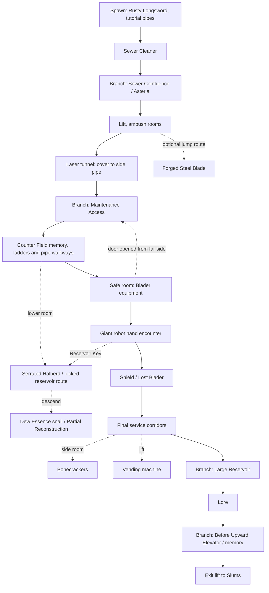
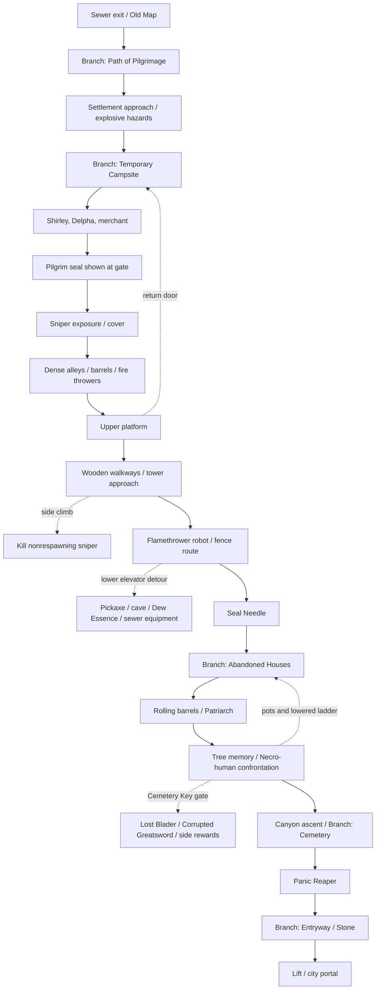

# AI LIMIT: Chinese, Japanese, and Korean original-source research

Research dates: 2026-10-13–14. Focus: material absent from the existing AI LIMIT notes, especially developer design explanations, evidence quality for combat numbers, and the first two areas. Spoilers follow.

## 1. Scope, evidence, and important corrections

I read `research/r2/CONTEXT.md` and the four existing documents it names. This report supplements their overview, story, and implementation plans. It does not treat their older evidence labels as independently verified.

**Evidence labels:** [V] a verified developer/publisher statement, official release note, or directly inspected game artifact; [C] a player, guide creator, reviewer, modder, or community wiki claim; [?] an unresolved claim, inference, proposed adaptation, or inaccessible lead. A wiki is [C], even when useful. Developer intent is [V] as a statement of intent, not proof that every player experiences the intended result.

- [C] The useful Chinese search names are **地城水道·西南段** and **壁外废墟·贫民窟**. The requested names 下水道镇 and 外墙废墟 resemble translations of the English area names; searching only those misses much of the Chinese guide corpus. [Chinese walkthrough](https://club.sonkwo.cn/posts/2381180), [Bilibili P1](https://www.bilibili.com/video/BV15hoaYwEiw/).
- [C] Cross-checks give **four named Branches in Sewer Southwest and five in Slums**. A creator's Slums chapter labels mention “晶枝1&2”, then “晶枝3” and “晶枝4”; this is not a reliable count of every checkpoint. [Branch list](https://www.powerpyx.com/ai-limit-all-branch-locations/), [creator's Slums description](https://www.youtube.com/watch?v=VJIHk0xPU1o).
- [V] The August 18, 2025 update changed **散落晨星 / Scattered Stars**: Counter Field costs no Sync, **but damage taken increases during use**. The older note's description of a freely spammable parry omits this tradeoff. The same update fixed chaining a weapon swap attack into another swap attack. [Official update](https://steamcommunity.com/games/2407270/announcements/detail/515218419125060247).
- [V] The current official September 22, 2026 notice identifies PC **1.2.004** and PS5 **1.000.033**. A launch guide, an October 2024 demo complaint, and a current combat test must therefore be kept separate. [Official current patch](https://steamcommunity.com/games/2407270/announcements/detail/669502126020363684).
- [?] I did **not** obtain a reproducible numerical datamine of base-game parry windows, dodge invulnerability, or all boss startup/active/recovery frames. I found qualitative move guides, a parry modification lead, and player measurements. Those are documented below without inventing frame tables.

## 2. Developer interviews and production talks

### 2.1 Yang Bin in Japanese: level design is a narrative-order problem

[V] AUTOMATON's **2024-04-18 email interview with producer 楊濱** is particularly useful. He describes level design as the hardest design task: allow exploration without making routes excessively complicated, while placing NPCs so that world and story information emerge in a workable sequence. Hardware differences also forced compromises. He says difficulty should be overcome through character growth, skills, and items, rather than demanding advanced execution from everyone. [Original Japanese interview](https://automaton-media.com/articles/interviewsjp/20240418-290244/).

[V] In the same interview, he distinguishes the game's rendering from anime characters with largely fixed lighting: the goal was anime rendering responding to changing environmental light. He connects the AI theme to AlphaGo's 2016 match and the visual direction to the 2017 BLAME! film, with Ghost in the Shell and AKIRA among broader influences. [Same interview](https://automaton-media.com/articles/interviewsjp/20240418-290244/).

[?] For the school milestone, the useful lesson is to place introductions and system unlocks along a readable route, then let optional loops deepen the world. Architectural complexity alone does not reproduce this design objective.

### 2.2 4Gamer: complete stage reconstruction, deliberate aggression

[V] 4Gamer's **2024-07-19 BitSummit interview** is with **周嘉偉, CE-Asia's publishing representative**, not Yang Bin. Zhou says the early team lacked enough technical knowledge and staff for a 3D action game; the later team had roughly twenty people. Stage arrangement and structure were completely rebuilt, while the basic action-RPG concept remained. He explains Sync as a way to make successful aggression rewarding and combat faster. [Japanese original](https://www.4gamer.net/games/768/G076875/20240719068/).

[?] Consequently, a 2019 demo is historical evidence, not a trustworthy layout reference for the 2025 sewer. The useful preservation target is the release-era sequence of loops and rewards.

### 2.3 GCORES: “Souls” design means embodied interaction and world exploration

[V] In the **2025 GCORES interview**, Yang treats weapon posture, timing, turning, and interaction as central to believable combat. World exploration includes enemy placement, drops, NPC events, and environmental storytelling, not merely scattered prose. By early 2023, bosses and NPCs existed but finished level environments remained a bottleneck. Publisher support enabled further rebuilding. He also says anime rendering was not an effortless cost-saving option: characters still needed to belong under complicated world lighting. [Original interview](https://www.gcores.com/articles/199162).

[?] A faithful structural adaptation should make an enemy's placement, reward, and nearby story clue work together. A visually similar corridor populated with arbitrary enemies misses the stated rationale.

### 2.4 Chinese post-launch interview: one resource was a simplifying choice

[V] 游戏茶馆's interview, reproduced by TMTPost, gives a useful explanation of the combat concept. Yang says the team retained a single resource partly to simplify design and establish a clear difference from existing games. They prototyped acquisition methods and settled on attacking as a workable source, then concentrated on making the system coherent. He considers stamina a good traditional design but not a necessary source of meaningful resistance. He also connects “Souls feel” to precise motion and discovery across systems, text, and NPC events. [Chinese interview](https://www.tmtpost.com/7543136.html).

[?] This supports retaining the shared resource loop. It does not justify making Sync depletion permanently trap inexperienced players; the magnitude of rewards and penalties still needs playtesting.

### 2.5 ChinaJoy 2025 talk: concrete art and production pipeline

[V] A **2025-08-09 published transcript** of Yang's ChinaJoy talk contains unusually practical details. The team requested ambitious, detailed scene concepts, then built inexpensive previews in **one or two days** to test feasibility. He advocates high design goals with modest production assumptions and early performance stress tests. The renderer moved from Unity Built-in to URP, then HDRP; their **Ai Toon** shader used a PBR base plus two-tone shading, rim lighting, and outlines. After agreeing on sample results, many parameters were locked so artists could aim for consistent Substance output. The level designer also deployed audio; the lead writer handled NPC interactions and overall progression. [17173 transcript mirror](https://www.sohu.com/a/922162305_119598).

[?] The applicable practice is a complete rough preview of the sewer-to-slums experience before polishing individual rooms, plus a small number of agreed lighting/material samples. This is an adaptation proposal, not a claim about Minecraft's renderer.

### 2.6 2026 talk: abandoned concept and a time-sensitive AI correction

[V] A **2026-08-10 transcript** of Yang's COREBLAZER talk shows early concept images, including a scene he says remained in the game for a long time but was abandoned because the team could not reconcile it with their level-art construction methods. He describes the project as the intersection of anime rendering, Souls combat, and science-fiction wasteland. He also discusses personal AI-assisted prototypes and research undertaken in **2026**. [Chinese transcript and images](https://www.sohu.com/a/1061099819_204824).

[V] An earlier IGN China interview said AI tools had not been used at that time. These statements concern different periods; the 2026 talk does not prove AI-generated assets were used to create the released game. [Earlier developer interview](https://www.taptap.cn/moment/554591722391208534).

[?] Concept images can include rejected layouts. Do not turn an attractive early scene into a claimed release-game room without gameplay corroboration.

## 3. Artbook, concept-art creators, and interpretation limits

### 3.1 A direct Chinese artist source

[V] **一轩HYX** posted **“发一发画的 无限机兵 概念图 1”** on **2025-06-16** and **“无限机兵 概念图 2”** on **2025-06-21**. The indexed profiles identify him as a core contributor/character concept designer and, on the second page, art director. The first description says these images were accumulated over years and assembled from scattered folders; the posts cross-link the two collections. These are artist-authored sources, unlike anonymous repost galleries. [Collection 1](https://www.bilibili.com/video/BV1w9MvzkERu/), [Collection 2](https://www.bilibili.com/video/BV1xqNkzdEAU/).

[?] Verification is at the page-description/profile level. I did not retrieve the complete video or comments, so I cannot responsibly name every depicted character, transcribe on-image design annotations, or claim a specific motif has an artist-confirmed meaning.

### 3.2 What is verified about the artbook

[V] The official Steam store lists a **Digital Artbook** in Deluxe content. A Japanese KADOKAWA retail listing likewise treats the artbook as **DLC**, rather than documenting a separate printed design book. [Steam](https://store.steampowered.com/app/2407270/AI_LIMIT/), [Japanese retailer](https://store.kadokawa.co.jp/shop/g/g7015025032741/).

[V] Official **1.2.002** notes added DLC-related content to the Deluxe digital artbook, and **1.2.003** removed duplicate pages. Therefore, an older screenshot compilation can differ from the current book. [Official 1.2.002](https://steamcommunity.com/games/2407270/announcements/detail/535504997467554952), [official 1.2.003](https://steamcommunity.com/games/2407270/announcements/detail/696511674679558428).

[V] The TMTPost interview displays images explicitly captioned as Deluxe-edition concept art. This is an accessible preview route, not access to the complete book. [Interview with previews](https://www.tmtpost.com/7543136.html).

[?] No authenticated full table of contents, stable page count, complete artist-credit list, or designer commentary on every boss was verified. No separate Chinese/Japanese/Korean printed setting book was established. The correct research record is “digital artbook exists; full contents not inspected.”

### 3.3 Community environmental interpretation and cut-content leads

[C] **秃各乐字** has a Bilibili detail-analysis series whose page lists sewer parts 1–2, Slums part 3, Rooftop Street part 4, and Flooded Street part 5. The fourth description credits **黑游戏作坊** for screenshots of datamined discarded content. The author explicitly lowers confidence in his proposed explanation of a widow's position amid fishing-gang territories. This is a useful example of separating observed placement from speculative production history. [Series page](https://www.bilibili.com/video/BV1ywJczzEN2/).

[?] This establishes a cut-content research lead, not a numerical combat datamine. Its disputed gang-territory reconstruction should not be adopted as developer intent.

[C] A Japanese player distinguishes modern-looking Blader weapons from more organic Necro weapons and appreciates hopeful NPC stories inside the ruined world. This is a player reading of the art, not an official style guide. [コジ's impressions](https://note.com/kojirrrr/n/nfc0aa20da119).

## 4. Combat numbers: findings and provenance audit

### 4.1 Measurements that can actually be cited

| Tag | Finding | Evidence and limit |
|---|---|---|
| [C] | Korean wiki editors report basic-hit Sync gain of **3 percentage points for small weapons** and **4 for large weapons** at Conversion 100; each additional 10 Conversion adds **0.3 / 0.4 points**, respectively. | [Namu](https://namu.moe/w/AI%20LIMIT). Community observations; not an extracted engine table. |
| [?] | A tentative model consistent with those observations is `gain = weapon_base × Conversion / 100`. | Derived from the Namu observations. Multihit attacks, finishers, buffs, and HUD rounding require separate testing. |
| [C] | Namu gives a Temporary Campsite dummy test: Stability **215→2.6% loss; 255→2.5%; 465→1.8%; 505→1.6%**. | [Namu](https://namu.moe/w/AI%20LIMIT). Editors themselves say the relationship with incoming damage is insufficiently verified. |
| [?] | The above does not establish a general Stability formula or prove a universal “1000 Stability = immunity” rule. | That exact rule from earlier notes was not independently reproduced here. |
| [C] | A Chinese creator tested **圣职者印记** after seeing Railgun trigger its effect twice. The description interprets “lightning damage +400” as an added lightning hit and suspects an internal cooldown. | [Bilibili test description](https://www.bilibili.com/video/BV1HjopYSEpY/). “Suspects” is essential; cooldown length was not established. |
| [C] | A Chinese Cheat Engine table author says the patch makes the parry active during its original startup, excludes distant beam attacks, and was adapted to **1.0.021** on April 9, 2025. | [3DM thread](https://bbs.3dmgame.com/thread-6584517-1-1.html). Search-index evidence only; attachment/code not obtained. |

[?] The Conversion expression is a candidate for a controlled experiment, not authorization to copy a supposed datamined formula into the remake. The dummy losses also need the attack, damage, seals, armor, build, and game version to become reproducible.

### 4.2 Verified patch numbers that change interpretation

[V] The **2025-08-18 official balance patch** supplies real numerical adjustments, although not baseline animation data:

| Tag | Change | Official value |
|---|---|---|
| [V] | Piercing Claw energy-claw hit Sync gain | +33%; activation gain reduced slightly without a published number |
| [V] | Thunder Step afterimage explosion | +20% damage |
| [V] | Materialism / Eureka counter cost | 25% → 20%; damage +9% |
| [V] | Envenomed Blade skill, first hit | +14% damage |
| [V] | Hunter's Blades skill, last hit | +20% damage |
| [V] | Holy Embrace skill | +15% damage |
| [V] | Minimum Pain | −13% damage |
| [V] | Lightning Tornado | −24% damage; stronger damage mitigation while active |

Source: [official announcement](https://steamcommunity.com/games/2407270/announcements/detail/515218419125060247). These are **relative changes**, not absolute damage multipliers. Launch-era build demonstrations can therefore overstate current performance.

### 4.3 Parry and dodge timing: what the sources do and do not show

[C] Chinese demo players repeatedly describe startup before Counter Field becomes active, difficulty reacting visually, and problems dodging multihit attacks. An October 2024 NGA-origin review gives a tentative “near one second?” impression for a defensive timing window; it does not measure frames and its wording around guard/parry is ambiguous. [Original feedback thread, page 2](https://steamcommunity.com/app/2407270/discussions/0/4690027719980058546/?ctp=2), [NGA review reproduced by Gamersky](https://www.gamersky.com/handbook/202410/1830133.shtml).

[C] A Taiwanese PTT player in September 2025 estimates needing to press parry **about 0.3 seconds before impact**. That estimates perceived lead time, not active-window duration. [Player report](https://www.ptt.cc/bbs/Steam/M.1757229474.A.195.html).

[C] Independent Japanese players also describe an early-input parry rather than an immediate just-guard. A May 24, 2025 review says the visible glow does not clearly communicate the active period; an October 3, 2026 play diary still describes the deployment delay. [maosy](https://note.com/maosy2929/n/n27fa6c646929), [recent C-field diary](https://coublood.hatenablog.com/entry/2026/10/03/100000).

[V] The **October 16, 2024 official demo patch** reduced Lore's HP/attack, altered hitboxes and tracking, and reduced HP remaining after the phase change. It also reduced robot poise/tracking, strengthened several weapon finishers' interrupt resistance and Sync recovery, and changed tutorial item order. [Official developer post](https://steamcommunity.com/app/2407270/discussions/0/4691153809033573637/).

[C] Release reviewers subsequently describe shorter recovery and more forgiving dodge/parry behavior than the demo. This is corroboration of changed feel, not a numbered frame specification. [UCG release review](https://www.ucg.cn/newsinfo/8172839.html), [游研社 release comparison](https://www.taptap.cn/moment/661948609851297363).

[?] **Unresolved:** startup/active/recovery frames; locked-on step versus unlocked roll invulnerability; cancel and buffer windows; exact weak-state vulnerability multiplier; every Sync-tier damage multiplier; boss per-hit motion values. No reproducible Chinese/Japanese/Korean dataset was found for these. The earlier Fextralife-linked tier table could not be revalidated and is not upgraded to [V].

### 4.4 A concrete measurement specification for the next stage

[?] Proposed verification, not research already performed: record the exact patch, NG cycle, difficulty mode, seals, weapon, upgrade, and stats. For parry, vary input offset against one repeatable single-hit attack; record the latest early failure, successful interval, and earliest late failure. Repeat for a projectile and beam separately. For dodge, test step and roll separately. Use high-rate capture and input timestamps; distinguish animation, collision, and rendered frames. At 60 fps a visible frame is about 16.7 ms, whereas a 20-tick Minecraft simulation step is 50 ms. Avoid rounding a guessed original-game window into Minecraft ticks and presenting it as a faithful reproduction.

## 5. Chinese boss guides: move cues rather than invented frame data

### 5.1 Lore / 迷失的枪兵 罗尔

[C] A **March 31, 2025 Chinese guide** gives these actionable tells: the opening jump can be parried; otherwise expect the follow-up spin. A paused sweep can continue, so the pause is not a guaranteed punish. Fast hand raise cues a ground strike, slow raise a grab. A thrust-like preparation can become a sweep, followed by a delayed vertical hit and fast forward poke. In phase two, target the crawling charge or the **third** left/right jump-pounce; the charge-parry cue is roughly two or three body lengths away. The author reports a repeatable behavior loop after those parries. [Chinese guide](https://www.wywyx.com/gonglue/497994.html).

[C] A Japanese release walkthrough describes two horizontal sweeps followed by a vertical strike, a jump slash often followed by a sweep, and a three-thrust string with a delayed second thrust and fast third. Its author found the release fight easier than the demo. [Screenshot walkthrough](https://otoki-game.com/ai-limit-firststage/).

[?] Phase-transition thresholds should not be frozen from approximate guide prose. The official demo notes explicitly changed phase-transition remaining health. Test the selected version before assigning a threshold. [Official demo changes](https://steamcommunity.com/app/2407270/discussions/0/4691153809033573637/).

### 5.2 Scavenger Patriarch / 拾荒者大族长

[C] A Chinese guide recommends counterclockwise movement toward his rear, staying close to suppress ranged behavior, and watching his **right hand** for the grab rather than the hammer, which he already carries over his shoulder. [Chinese move explanation](https://www.php.cn/faq/1284610.html).

[C] Japanese guidance records one-shot and three-shot ranged variants and warns that the later leaping attack hits twice. Its author finds parrying useful, whereas the Chinese Media guide prefers close dodge-and-punish. This is a strategy disagreement, not conflicting frame measurements. [Japanese route/fight guide](https://otoki-game.com/ai-limit-2nderea/), [Chinese Media guide](https://club.sonkwo.cn/posts/2381180).

### 5.3 Panic Reaper / 恐慌收割者

[C] The Chinese guide distinguishes Piercing from the scream's Sync-draining Infection. After two spins, lowered arms signal an ending; horizontal arms signal a third hit. [Chinese guide](https://club.sonkwo.cn/posts/2381180).

[C] Japanese guidance warns about the rotation's final hit and treats a rush or completed four-hit string as an opening. [Japanese guide](https://al-gest.com/ai-limit/ai-limit-story02/).

### 5.4 Creator material for deeper analysis

| Tag | Material | What is actually established |
|---|---|---|
| [C] | [步步深挖 boss strategies](https://www.bilibili.com/video/BV1veZ9YaEZA/) | Indexed collection includes a dedicated early trio installment and another for Hunter/Ursula/Persephone; associated regular-enemy guide also appears. Full video timing was not extracted. |
| [C] | [圣子洛希德招式拆解](https://www.bilibili.com/video/BV143ZYYoEdn/) | Explicit move-breakdown video. The title calls Loskid the best boss; that is the creator's opinion. No verified frame chart obtained. |
| [C] | [八周目法师全BOSS](https://www.bilibili.com/video/BV1n9RBYXEk9/) | A guide advertised as an eight-cycle mage strategy. It is a build demonstration lead, not evidence all bosses have easy parry windows. |
| [C] | [DLC Millaire breakdown](https://gl.ali213.net/html/2026-4/1759523_9.html) | Reports delayed ice projectiles overlapping subsequent spells, displacement afterimages, and recovery fields; recommends individual high-damage hits and avoiding greed. Useful for later projectile-overlap design. |

[?] No base-game boss entry above should be described as “frame data.” The useful content is tell → follow-up → positioning → punish opportunity. Numeric timings remain a measurement task.

## 6. First two areas: checkpoint and route reconstruction

### 6.1 Terminology and named Branches

All positions below are [C], corroborated through guide text and screenshots. They are a topological inventory, not a metrically surveyed map. [Named Branch inventory](https://www.powerpyx.com/ai-limit-all-branch-locations/). Chinese labels follow the [Chinese route](https://club.sonkwo.cn/posts/2381180).

| Area | Chinese Branch | English counterpart | Where it belongs |
|---|---|---|---|
| Sewer Southwest [C] | 集水区 | Sewer Confluence | After Sewer Cleaner, at Asteria |
| Sewer Southwest [C] | 维修通道 | Maintenance Access | After laser tunnel, inside side pipe |
| Sewer Southwest [C] | 大蓄水池 | Large Reservoir | Immediately before Lore |
| Sewer Southwest [C] | 上行电梯前 | Before Upward Elevator | After Lore, before exit lift |
| Slums [C] | 朝圣小径 | Path of Pilgrimage | Below entry ladder |
| Slums [C] | 临时营地 | Temporary Campsite | Right side of hub, near shop |
| Slums [C] | 废屋群 | Abandoned Houses | Atop platforms before Patriarch route |
| Slums [C] | 墓园 | Cemetery | Right of canyon route before Reaper |
| Slums [C] | 入城通道 | Entryway | Inside building after Reaper |

[C] Japanese guides use 集水エリア, メンテナンス通路, 貯水池, 上りエレベーター前, 巡礼の道, 仮設キャンプ, 廃屋群, and 墓地. One guide labels the post-Reaper Branch 高架橋; retain the source's wording instead of silently asserting an exact official three-language glossary. [Japanese Slums chart](https://al-gest.com/ai-limit/ai-limit-story02/), [Japanese sewer chart](https://al-gest.com/ai-limit/ai-limit-trial/).

### 6.2 Sewer Southwest: schematic

[?] The following is my reconstruction from the cited routes; arrows mean traversable progression, not world coordinates. The shortcut and optional-resource pattern is corroborated; dimensions, compass orientation, and every lesser pickup are not surveyed.

[C] Diagram basis: [Japanese collection chart](https://al-gest.com/ai-limit/ai-limit-trial/), [English collection cross-check](https://www.powerpyx.com/ai-limit-sewer-town-southwest-walkthrough/).

### 6.3 Sewer Southwest: practical inventory

| Tag | Place / requirement | Reward or encounter | Source |
|---|---|---|---|
| [C] | Early tutorial ladder, optional opposite direction | Large Void beast; upgrade carbon | [Japanese chart](https://al-gest.com/ai-limit/ai-limit-trial/) |
| [C] | Before first Branch | Sewer Cleaner unlocks Railgun; Old Notebook is nearby | [Creator P1, 09:00](https://www.youtube.com/watch?v=n5fLvUZh0ww&t=540s) |
| [C] | Asteria after repairing first Branch | Life Dew and choice of Blader sword, dual swords, or greatsword | [Japanese chart](https://al-gest.com/ai-limit/ai-limit-trial/) |
| [C] | Destructible side route with a running jump | Forged Steel Blade / 精制钢刀 | [Creator P1, 11:20](https://www.youtube.com/watch?v=n5fLvUZh0ww&t=680s) |
| [C] | Safe near pipe-carrying brute | Traveler's Outfit / 旅行轻装 | [Creator P1, 19:50](https://www.youtube.com/watch?v=n5fLvUZh0ww&t=1190s) |
| [C] | Memory beyond Maintenance Access | Counter Field unlock | [Japanese chart](https://al-gest.com/ai-limit/ai-limit-trial/) |
| [C] | Safe on upper loop | Blader Armor + Visor; return door to Branch | [Japanese chart](https://al-gest.com/ai-limit/ai-limit-trial/) |
| [C] | Lower box-filled room | Serrated Halberd; dark-room enemies | [Japanese screenshot route](https://otoki-game.com/ai-limit-firststage/) |
| [C] | Giant robot hand encounter | Reservoir Key; robot can be bypassed for main progression | [English collection guide](https://www.powerpyx.com/ai-limit-sewer-town-southwest-walkthrough/) |
| [C] | Locked lower reservoir | Snail drops Dew Essence; further descent has Partial Reconstruction and floating enemy | [English collection guide](https://www.powerpyx.com/ai-limit-sewer-town-southwest-walkthrough/) |
| [C] | Main route after giant robot | Shield; first Lost Blader drops Ragged Hood | [English collection guide](https://www.powerpyx.com/ai-limit-sewer-town-southwest-walkthrough/) |
| [C] | Side room before final ladder descent | Bonecrackers / 碎骨者 | [Creator P1, 41:40](https://www.youtube.com/watch?v=n5fLvUZh0ww&t=2500s) |
| [C] | Side lift near final Branch | Opossum vending machine; Ponytail costs 1,000 Crystals | [English collection guide](https://www.powerpyx.com/ai-limit-sewer-town-southwest-walkthrough/) |
| [C] | Lore defeated / postboss memory | Arboretum Key, Void Nucleus; Metastability at exit Branch | [English collection guide](https://www.powerpyx.com/ai-limit-sewer-town-southwest-walkthrough/) |

[C] The screenshot route shows ambushes behind doors, stone throwers supporting melee enemies, narrow-footing pipe brutes, and machines fighting other enemies. It also describes upper/lower routes converging on the same safe room. These are more informative encounter references than “put sewer mobs everywhere.” [Japanese screenshot route](https://otoki-game.com/ai-limit-firststage/).

[?] Structural lesson: the first loop teaches traversal and return-door recognition; the giant laser threat becomes an optional key source; the key turns a previously inaccessible reward into a reason to revisit. For the remake, preserve that dependency chain while redesigning geometry and appearances.

### 6.4 Slums: schematic

[?] Reconstructed topology, not a scale map. The Cemetery Key opens a **reward detour**, not a mandatory purchase for the main Reaper route.

[C] Diagram basis: [Japanese collection chart](https://al-gest.com/ai-limit/ai-limit-story02/), [English collection cross-check](https://www.powerpyx.com/ai-limit-outer-wall-ruins-slums-walkthrough/).

### 6.5 Slums: practical inventory

| Tag | Place / requirement | Reward or function | Source |
|---|---|---|---|
| [C]/[V] | Early Slums corpse location [C] | Old Map pickup/tutorial screen directly inspected [V] | [Route report](https://otoki-game.com/ai-limit-2nderea/), [game screenshot](https://otoki-game.com/wp-content/uploads/2025/05/865fa1150fc85abf6e79a05e28d71db5-1024x576.jpg) |
| [C] | Campsite girl, repeated dialogue | Naming event and Seal of Pilgrim; opens the exit conversation | [Japanese screenshot route](https://otoki-game.com/ai-limit-2nderea/) |
| [C] | Delpha, then cultivate and speak again | Purified Soil increases Life Dew uses from 3 to 4; quest begins | [Japanese screenshot route](https://otoki-game.com/ai-limit-2nderea/) |
| [C] | Campsite merchant | Cemetery Key costs 2,500 Crystals; optional later gate | [English collection guide](https://www.powerpyx.com/ai-limit-outer-wall-ruins-slums-walkthrough/) |
| [C] | First dangerous alleys | Drizzle / 细雨 normal seal | [Creator P2, 11:20](https://www.youtube.com/watch?v=VJIHk0xPU1o&t=680s) |
| [C] | Tower side climb | Sniper can be removed permanently; tower ladder shortcut | [Japanese screenshot route](https://otoki-game.com/ai-limit-2nderea/) |
| [C] | Flamethrower Sewer Cleaner on route | Flame Jet / 火焰喷射 | [Creator P2, 11:20](https://www.youtube.com/watch?v=VJIHk0xPU1o&t=680s) |
| [C] | Building left of ladder leading to Abandoned Houses | Seal Needle / 刻印金针, enabling seal rewriting | [Creator P2, 11:20](https://www.youtube.com/watch?v=VJIHk0xPU1o&t=680s) |
| [C] | Lower elevator detour | Pickaxe; Rusty Pipe in sewer cell; Scavenger's Clothing in chest | [English collection guide](https://www.powerpyx.com/ai-limit-outer-wall-ruins-slums-walkthrough/) |
| [C] | Breakable crates before blue-crystal cave | Butterfly drops Dew Essence; cave also has Sacred Blood Crystal and diamond material | [Japanese collection chart](https://al-gest.com/ai-limit/ai-limit-story02/) |
| [C] | After Patriarch, memory at tree | Hardened Skin / 以身作盾; spelling varies in guide text | [Creator P2, 32:00](https://www.youtube.com/watch?v=VJIHk0xPU1o&t=1920s) |
| [C] | Left side route by Mud Ball maker | Iron Pot headwear; lowered ladder back to prior Branch | [Japanese collection chart](https://al-gest.com/ai-limit/ai-limit-story02/) |
| [C] | Cemetery Key gate, gap/drop toward Lost Blader | Corrupted Blader Greatsword / 侵蚀机兵大剑 | [English collection guide](https://www.powerpyx.com/ai-limit-outer-wall-ruins-slums-walkthrough/) |
| [C] | Other branch behind key gate, spike-trap route | Breath of Life on backpack | [English collection guide](https://www.powerpyx.com/ai-limit-outer-wall-ruins-slums-walkthrough/) |
| [C] | Reaper defeated | Piercing Claw and Elite Necro's Nucleus | [English collection guide](https://www.powerpyx.com/ai-limit-outer-wall-ruins-slums-walkthrough/) |
| [C] | Stone beside Entryway Branch | First Stone event; Ore Bell | [English collection guide](https://www.powerpyx.com/ai-limit-outer-wall-ruins-slums-walkthrough/) |

[C] The Chinese route alternates sniper exposure and careful explosive-alley clearing. Removing the sniper permits safer exploration. [Chinese Media route](https://club.sonkwo.cn/posts/2381180).

[?] These are three different encounter problems: exposure, close-range explosive management, and reclaiming a threatened route. Building only narrow corridors full of shooters would flatten the area's pacing.

### 6.6 Creator timestamps for visual follow-up

[C] **水子哥的综合游戏室** supplies chapter markers in his own mirrored video descriptions. These are navigation aids, not evidence that every event happens at the exact displayed second:

| Tag | Sewer P1 | Slums P2 |
|---|---|---|
| [C] | 09:00 notebook, Cleaner, Railgun | 00:00 Old Map and early Branches |
| [C] | 11:20 Asteria, first Branch, steel blade | 05:05 Shirley/Delpha, soil, key |
| [C] | 19:50 traveler outfit, Counter Field | 11:20 Drizzle, Flame Jet, needle |
| [C] | 26:00 Blader equipment, halberd, key | 24:40 pickaxe, essence, pipe, clothes |
| [C] | 32:00 essence, healing spell, Shield | 32:00 Patriarch, memory, Iron Pot |
| [C] | 41:40 Bonecrackers, vendor | 37:50 Lost Blader / checkpoint segment |
| [C] | 45:00 Lore, Metastability, exit Branch | 44:00 Reaper, exit, Stone |

Sources: [P1 Bilibili page](https://www.bilibili.com/video/BV15hoaYwEiw/), [P1 creator mirror](https://www.youtube.com/watch?v=n5fLvUZh0ww), [P2 creator mirror](https://www.youtube.com/watch?v=VJIHk0xPU1o). Other useful indexed collection: [银子假人 full exploration](https://www.bilibili.com/video/BV1e5o2YuED1/), including the Slums sniper/hidden-path installment.

## 7. Maps and route resources beyond the milestone

### 7.1 What the actual in-game map records

[V] The inspected Old Map tutorial screenshot says resting at a Branch records visited areas, important points, merchant locations, and current terrain changes. It is evidence for a map whose information changes during exploration, not a comprehensive surveyed floorplan. [Inspected game screenshot](https://otoki-game.com/wp-content/uploads/2025/05/865fa1150fc85abf6e79a05e28d71db5-1024x576.jpg).

[V] Official Japanese patch notes also mention adding markers for collected soil and fixing map-marker problems after long periods without opening the map. [Official Japanese archive](https://steamcommunity.com/app/2407270/announcements/?l=japanese).

[?] I did not verify a downloadable complete, to-scale atlas or an interactive map with every enemy/item. A Bilibili search snippet mentions a hand-drawn map video, but I could not resolve a dependable direct video URL. It is a lead, not a delivered atlas.

### 7.2 A multilingual route atlas index

[C] The following are the Japanese guide's actual chapter destinations. These link to screenshot route charts, not coordinate maps. The table is useful for locating later area's entrances, loops, and collectibles without translating an English name back into Japanese blindly. [Japanese story index](https://al-gest.com/ai-limit/ai-limit-story/).

| Tag | Area / scope | Japanese route source |
|---|---|---|
| [C] | 地城水道·西南段 / Sewer Southwest | [地底水路](https://al-gest.com/ai-limit/ai-limit-trial/) |
| [C] | 壁外废墟·贫民窟 / Slums | [壁外の廃墟](https://al-gest.com/ai-limit/ai-limit-story02/) |
| [C] | 沉没之都·上层 / Rooftop + Flooded streets | [沈みゆく街・上層](https://al-gest.com/ai-limit/ai-limit-story03/) |
| [C] | 薄暮山·枯萎林区 / Withered Forest | [枯れ木の森](https://al-gest.com/ai-limit/ai-limit-story13/) |
| [C] | 沉没之都·下层 / Underground Parish | [沈みゆく街・下層](https://al-gest.com/ai-limit/ai-limit-story05/) |
| [C] | 圣父大教堂·下层 | [大聖堂（下層）](https://al-gest.com/ai-limit/ai-limit-story04/) |
| [C] | 地城水道·北段 | [地底水路（北部）](https://al-gest.com/ai-limit/ai-limit-story06/) |
| [C] | 壁外废墟·古代机械工厂, early visit | [古の機械工場](https://al-gest.com/ai-limit/ai-limit-story07/) |
| [C] | 薄暮山·深渊灵龛 | [深淵の霊殿](https://al-gest.com/ai-limit/ai-limit-story08/) |
| [C] | Collapsed cavern → Central Station | [洞窟〜中央駅](https://al-gest.com/ai-limit/ai-limit-story09/) |
| [C] | Machine works side path → research center | [工場の脇道〜研究所](https://al-gest.com/ai-limit/ai-limit-story10/) |
| [C] | Living Pond → later cathedral route | [命の池〜進化する殿堂](https://al-gest.com/ai-limit/ai-limit-story11/) |
| [C] | Uncharted Realm → Sphere Gate | [未成領域〜スフィアズゲート](https://al-gest.com/ai-limit/ai-limit-story12/) |

[C] The Chinese creator's collection is organized differently: P3 Rooftop Street; P4 Flooded Street; P5 Withered Forest; P6 early Underground Parish + Cathedral Lower; P7 Sewer North; P8 Spirit Depths; P9 middle Parish + Sewer Center + Tree Courtyard; P10 Machine Works; P11 Cathedral Upper; P12 Sphere/Elysium. [Chinese collection listing](https://www.bilibili.com/video/BV15hoaYwEiw/).

[?] These route indexes are not a single mandatory visit order. Optional zones, backtracking, and early side entrances matter. For later detailed build work, extract each chapter into a node/edge graph before assigning Minecraft coordinates.

## 8. Player praise and criticism across languages

These are small, purposive samples. No country-wide consensus, representative survey, or frequency ranking is claimed.

### 8.1 Chinese and Traditional Chinese

- [C] TapTap players praise the Maintenance Access return door and routes that converge after ladders, narrow bridges, and drops. The same review acknowledges reused environments/enemies. [TapTap reviews](https://www.taptap.cn/app/741260/review).
- [C] A September 2025 PTT player praises compact exploration, optional paths, interconnected later areas, costume variety, and price. Criticisms include incomplete seamless connectivity, late-game pressure, and the difficulty of recovering Sync after mistakes. [PTT firsthand completion report](https://www.ptt.cc/bbs/Steam/M.1757229474.A.195.html).
- [C] IGN China gives **7/10**, distinct from IGN's English review. Its reviewer praises character art, movement, and optimization but criticizes repetitive basic encounters and weak combat interaction; using expensive skills can feel less efficient than continuing normal attacks. [Chinese review](https://www.ign.com.cn/wu-xian-ji-bing/53484/review/er-ci-yuan-lei-hun-dong-zuo-rpgwu-xian-ji-bing-ping-ce-7-fen-ign-zhong-guo).
- [C] Tieba build advice recommends Stability, relevant elemental/status resistance, and optionally Sync recovery rather than a universal damage-only setup. It also recommends the corrupted greatsword as an accessible progression tool. Only indexed thread text was retrievable. [Tieba thread](https://tieba.baidu.com/p/9665802460).
- [C] Another Chinese player argues that high-stagger weapons and spells permit repeating knockdowns instead of engaging deeply with the enemy's moves; Piercing Claw lets a caster trade healing capacity for Sync. This explains why “easy with a build” and “hard to learn by parrying” can coexist. [Billy Huang's review](https://steamcommunity.com/profiles/76561198797651780/recommended/2407270/).
- [C] October 2024 feedback also reports input, recovery, visual-feedback, and camera problems. Those comments establish demo complaints, not that the same bugs still exist in 1.2.004. [Demo feedback, page 6](https://steamcommunity.com/app/2407270/discussions/0/4690027719980058546/?ctp=6).

[?] Practical implication: optional powerful rewards help players who struggle with execution, but a single dominant stagger loop can erase the intended weapon variety. Evaluate both an ordinary beginner build and a deliberately optimized build.

### 8.2 Japanese

- [C] コジ praises aggressive Sync combat, the difference between Counter Field and Thunder Step, weapon visual variety, and NPCs who retain hope after catastrophe. Criticisms include pervasive delayed attacks and running-jump input during platforming. [Firsthand impressions](https://note.com/kojirrrr/n/nfc0aa20da119).
- [C] maosy appreciates projectile reflection but finds parry feedback difficult to read, boss difficulty uneven, the map of limited practical use, and encountered infinite-loading and a Persephone finishing-interaction failure. These are specific reports, not current universal failures. [May 2025 impressions](https://note.com/maosy2929/n/n27fa6c646929).
- [C] A March 29, 2025 PC player praises the early shortcuts and aggressive resource loop, while describing parry as extremely strong and requiring early input. [Japanese PC blog](https://gamedaisukinahito.blog.fc2.com/blog-entry-1682.html).
- [C] A September 20, 2026 completion report praises quick retries and combat but criticizes dark platforming and a midgame runback with dangerous ordinary enemies. This is **Japanese material**: the `?hl=ko` version is explicitly machine-translated by note.com and must not be counted as a Korean player's response. [Japanese original](https://note.com/kittyapple_0000/n/na2178f1989b5).

[?] Two useful design targets follow: readable silhouettes/footing under dark lighting and parry feedback that clearly distinguishes deployment from the active interval. Neither requires copying the original interface or art.

### 8.3 Korean: actual player sources, not translated Japanese pages

- [C] **Ruliweb, 2025-03-28**, “초반 장단점”: the writer likes the familiar FromSoftware feel, approachable difficulty, female lead, and low price; says Khazan is more fun. It is a brief first impression, not a full completion review. [Thread](https://bbs.ruliweb.com/game/86875/read/2541911).
- [C] **Ruliweb, 2025-08-15**: a different player strongly prefers Code Vein and calls AI LIMIT mediocre between anime presentation and Souls mechanics. The replies do not constitute unanimous agreement. [Thread](https://bbs.ruliweb.com/community/board/300143/read/71912141).
- [C] **Ruliweb, 2025-04-24**: one Hunter-of-Bladers tip says four or five poison darts inflicted poison. This is a specific player tactic, not a measured universal resistance threshold. [Thread](https://bbs.ruliweb.com/game/86875/read/2543490).
- [C] **DC Inside, 2025-04-30**: a player complains that a delayed follow-up after a laser is difficult to predict. The embedded gameplay was not inspected, so the precise boss and mechanic remain [?]. [AI 리미트 gallery post 677](https://gall.dcinside.com/mgallery/board/view/?id=ailimit&no=677).
- [C] Korean Steam reviews collected by GTAKU include praise for exploration, aggressive combat, and optimization, alongside criticism of translation and uneven boss animation/difficulty. These are individual reviews in an aggregator; the sample is not a Korean-wide rating. [Review collection](https://www.gtaku.net/gameinfo/2407270).
- [C] Namu documents inconsistent Korean names for Sync, people, places, and abilities. [?] Its suggestion that Korean localization came through AI translation of Japanese is a **community inference**, not an established developer workflow. [Namu](https://namu.moe/w/AI%20LIMIT).

[?] For the remake, define one Korean name per system and a source-name crosswalk for researchers. This addresses an observable comprehension problem without making unsupported allegations about the original localization process.

## 9. Coverage gaps, rejected sources, and usable research package

| Tag | Source family | Result / limitation |
|---|---|---|
| [V]/[C] | Chinese developer interviews and talks | Strong original statements through Japanese interviews, GCORES, 游戏茶馆, 17173 transcript, and 2026 talk. Evidence above identifies speaker and date. |
| [V]/[C] | Bilibili | Artist-authored concept posts; player guide metadata/descriptions; boss-breakdown and cut-content leads. Direct pages/API often returned 412. Comments could not be systematically retrieved. |
| [C] | Baidu Tieba | Relevant build advice indexed; direct request returned a security check. Do not characterize the whole forum from these snippets. |
| [C] | NGA / Zhihu | NGA-origin reviews survive with clear author/source credit on Gamersky; Zhihu mostly surfaced announcements and broad discussion, not reproducible combat tables. |
| [?] | MC百科 / mcmod.cn / MCBBS | Targeted AI LIMIT searches did not yield a dependable original-game mechanics or map corpus. No evidence is inferred from unrelated Minecraft pages. |
| [C] | Japanese wiki/guide/blog sources | Al-gest and Otoki provide extensive route charts; note.com and PC blogs provide firsthand impressions. Some guide spellings vary. |
| [?] | Pixiv / BOOTH / FANBOX / Nicovideo / X | No verified numerical/map dataset or designer commentary found there. One Chinese visual-guide description credits a Pixiv cover artist; that is fan-art provenance, not an official concept source. [Guide description](https://www.bilibili.com/video/BV1T1GzzuENC/). |
| [C] | Namu / Ruliweb / DC Inside | Actual Korean numerical observations, build tips, criticism, and localization issues recovered. |
| [?] | Arca Live / Naver cafes | Queries did not recover a dependable relevant dataset; Naver access was blocked by robots. This is a coverage gap, not evidence the communities lack discussion. |

[?] Reject search-optimized articles that promise hidden frame data while describing a stamina bar, fabricated bosses, or unrelated equipment. Examples encountered include a purported [parry frame guide](https://www.xmodhub.com/info/zh-tw/blog/zh-tw-ai-limit-parry-timing-guide/) discussing stamina depletion, and a supposed [Lore guide](https://m.bobobaike.com/news/298903.html) saying the sewer permanently closes after Lore while describing ranged gun attacks. These conflict with the stronger route corpus. They are documented as rejected leads and are **not** used to fill numeric gaps.

[?] Remaining work is specific: inspect the purchased current artbook; obtain creator permission/access where necessary for video-level annotations; test combat constants on one fixed build; record major route junctions in-game; and measure dimensions separately from route topology. The two graphs above support blockout planning now, but cannot certify complete original-game reconstruction.

Research artifacts written under `research/r2/codex_raw/` include native-language page text, search result records, creator-description fetches, official Steam news JSON, screenshot URL inventories, and the inspected Old Map pickup screenshot. Some filenames in that shared directory belong to other research lanes; this report's references identify the relevant sources. No credential file was displayed or copied.

## Summary

[V] 가장 중요한 새 자료는 제작자와 아트 담당자의 원문이다. 楊濱은 자유로운 탐색, 복잡하지 않은 동선, NPC를 통한 정보 공개 순서를 함께 맞추는 것이 가장 어려웠다고 설명한다. 2025년 강연에서는 큰 장면의 컨셉을 먼저 만들고 1~2일짜리 저비용 프리뷰로 검증했다고 밝혔다. [일본어 인터뷰](https://automaton-media.com/articles/interviewsjp/20240418-290244/), [개발 강연](https://www.sohu.com/a/922162305_119598).

[V] 一轩HYX의 Bilibili 컨셉아트 모음 두 편을 찾았다. 프로필은 역할을 확인해 주지만, 영상 전체와 그림 속 주석까지 검증하지는 못했다. 공식 디지털 아트북은 존재하고 DLC 자료 추가·중복 페이지 삭제도 확인된다. 별도 종이 설정집이나 전체 목차는 미확인이다. [컨셉 1](https://www.bilibili.com/video/BV1w9MvzkERu/), [컨셉 2](https://www.bilibili.com/video/BV1xqNkzdEAU/), [공식 기록](https://steamcommunity.com/app/2407270/announcements/?l=japanese).

[C] 첫 두 구역의 연구용 검색어는 地城水道·西南段과 壁外废墟·贫民窟이다. 하수도 4개, 빈민가 5개의 이름 있는 체크포인트를 교차 확인하고, 숏컷·키·보상·위험 요소를 두 개의 경로 그래프로 정리했다. 하수도는 되돌아오는 문과 거대 로봇의 열쇠 보상, 빈민가는 저격선 통과→폭발물 골목→저격수 제거의 흐름이 핵심이다. [?] 그래프는 실측 지도나 전체 아이템 검수표가 아니다. [중국어 원본](https://club.sonkwo.cn/posts/2381180), [일본어 하수도](https://otoki-game.com/ai-limit-firststage/), [일본어 빈민가](https://otoki-game.com/ai-limit-2nderea/).

[C] 중국 보스 공략에서는 로르의 손 들기·연속 찌르기·세 번째 도약, 족장의 오른손 잡기 신호, 수확자의 회전 후 팔 위치처럼 실제로 활용 가능한 관찰점을 얻었다. [?] 패리·회피 무적·보스 선딜의 재현 가능한 프레임 표는 찾지 못했다. 0.3초 같은 값은 체감 입력 선행 시간이지 확정 판정창이 아니다. [로르](https://www.wywyx.com/gonglue/497994.html), [족장](https://www.php.cn/faq/1284610.html), [체감 보고](https://www.ptt.cc/bbs/Steam/M.1757229474.A.195.html).

[V] 버전 차이가 중요하다. 2025년 8월부터 패리 비용 제거 각인은 사용 중 피격 피해 증가라는 대가를 가진다. 기술 전환 공격의 재귀 연계도 수정되었다. 따라서 출시 초기 영상으로 현재 밸런스를 단정하면 안 된다. [공식 변경](https://steamcommunity.com/games/2407270/announcements/detail/515218419125060247).

[C] 세 언어의 소규모 표본은 탐색, 공격적인 전투, 의상과 가격을 좋아하면서도 지연 공격, 패리 피드백, 어두운 발판, 반복 자원, 번역 문제를 지적한다. 한국어로 자동 번역된 일본 블로그를 한국 플레이어 의견으로 세지 않았다. [?] 학교 과제에서는 원작 수치를 추측해 복사하기보다 두 구역의 이동·보상 구조를 보존하고, 새 이름·외형·조명 아래에서 초보 빌드와 강한 빌드를 각각 테스트하는 편이 근거에 맞다. [일본 후기](https://note.com/kojirrrr/n/nfc0aa20da119), [한국 첫인상](https://bbs.ruliweb.com/game/86875/read/2541911), [한국 리뷰 모음](https://www.gtaku.net/gameinfo/2407270).
