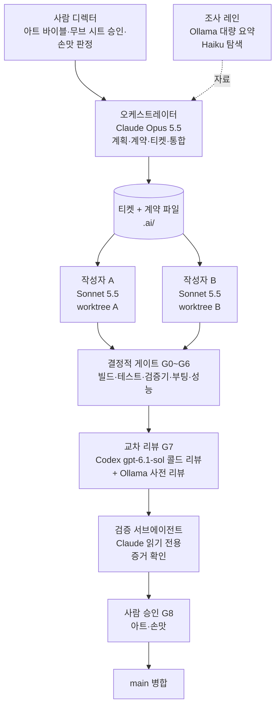

# 에이전트 파이프라인 설계 (2026-10-13)

> **목표:** Claude Code(전 모델), OpenAI Codex, Ollama Cloud를 함께 써서 Minecraft 1.21.1 + NeoForge 소울라이크 맵을 최고 퀄리티로 만든다.
>
> **근거:** 공식 문서, 논문, 엔지니어링 글, Reddit, 유튜브, X를 조사했다. 상세 노트와 출처 URL은 [`sources/`](#출처)에 있다.
>
> **표기:** **[확인]** 공식 문서·원문·직접 테스트 · **[커뮤니티]** 사용자 의견 · **[추정]** 추론

---

## 0. 한 장 요약

### 다섯 가지 원칙
1. **작성자는 하나, 조언자는 여럿.** 파일(모드 모듈, 데이터팩 네임스페이스, 모델, 애니메이션 세트)마다 쓰는 에이전트는 하나다. 다른 에이전트는 리뷰와 조사만 한다.
2. **역할이 아니라 맥락으로 나눈다.** "기획 → 구현 → 테스트 → 리뷰" 역할 사슬은 전달 비용만 늘린다. "보스 X 한 마리의 엔티티 코드·모델·애니메이션·드랍"처럼 맥락이 닫힌 덩어리를 한 에이전트에게 맡긴다.
3. **검증은 결정적 게이트가 먼저다.** 빌드, 테스트, 검증기를 먼저 통과시키고, LLM 판정은 보조로만 쓴다. 에이전트의 "다 됐다"는 말이 아니라 증거 파일로 판단한다.
4. **리뷰는 다른 모델 계열이, 맥락 없이 한다.** Claude가 쓴 diff는 Codex가 처음 보는 상태로 리뷰한다. 같은 모델이 자기 결과를 채점하게 두지 않는다.
5. **취향은 사람이 결정한다.** 대표 모델, 픽셀 텍스처, 전투 손맛, 연출, 난이도는 사람이 주도하고 에이전트는 보조한다. 품질 때문이기도 하고, 배포 정책 때문이기도 하다.

### 모델 역할

| 역할 | 모델 |
| --- | --- |
| 오케스트레이터(계획, 계약, 통합) | Claude **Opus 5.5** (기본 노력 medium, 어려운 설계는 high) |
| 작성자(구현) | Claude **Sonnet 5.5**, 어려운 부분은 Opus 5.5 |
| 탐색, 로그 분류, JSON 검사 | Claude **Haiku 5.5** |
| 드문 아키텍처·근본 원인 판단 | Claude **Fable 5.1** (기본 차단, 필요할 때만) |
| 교차 리뷰(모든 diff) | Codex **gpt-6.1-sol** (high), 아주 어려운 디버깅만 gpt-6-astra |
| 엄격한 JSON 생성·추출 | Codex **gpt-6-luna** (구조화 출력) |
| 대량 조사·요약 | Ollama **deepseek-v4.1-flash**, **glm-5.3-flash**, **gpt-oss:120b** |
| 저렴한 사전 리뷰(발견 사항 추가) | Ollama **glm-5.3**, **kimi-k2.7-code** |
| 스크린샷·텍스처 1차 분류 | Ollama **gemma4:31b** → Claude 또는 kimi-k3 |

### 누가 주도하나

| 단계 | 주도 | 에이전트가 하는 일 |
| --- | --- | --- |
| 커스텀 NeoForge 모드, KubeJS, 데이터팩 | **에이전트** (게이트 통과 조건) | 작성, 수정, 테스트 |
| 기획 문서, 보스 무브 시트, 아트 바이블, 성능 예산 | 사람 | 초안, 질문, 교차 비판, YAML 계약으로 변환 |
| 대표 모델(보스·무기), 픽셀 텍스처 | 사람 | 블록아웃, UV 템플릿, 대칭, 이름 정리, 내보내기, 검증, 렌더 시트 |
| 작은 소품·블록 모델 | 에이전트 → 사람 검토 | 헤드리스 MCP로 제작 |
| LabPBR `_n`/`_s` 맵 | 에이전트 초안 → 사람 수정 | 노멀·높이 초안, 채널 패킹 |
| Epic Fight 전투 애니메이션, GeckoLib 애니메이션 | 사람 | 내보내기, 검증, 무브 시트와 타이밍 대조 |
| Animated Java 컷신, 레벨 건축, 난이도 | 사람 | 트리거·카메라·사운드 데이터팩 연결, 조우 테스트 |
| QA | 에이전트(스모크) + 사람(손맛) | 클라이언트 경로 순회, 스크린샷, 프로파일 |

---

## 1. 근거: 무엇이 효과가 있고 무엇이 없나

| 발견 | 내용 | 출처 |
| --- | --- | --- |
| 멀티 에이전트는 나눌 수 있는 일에서만 이득 | 260개 구성 실험에서 단일 에이전트 대비 +81%(분해 가능한 작업) ~ −70%(순차 계획). 단일 에이전트가 이미 45% 이상이면 에이전트를 늘릴수록 손해. 독립 에이전트는 오류를 17.2배 증폭, 중앙 검증자를 두면 4.4배 | Google/MIT 2025-12 [확인] |
| 마인크래프트 제작 계획은 단일이 낫다 | PlanCraft 벤치마크에서 모든 멀티 에이전트 변형이 단일보다 나빴다 | 같은 논문 [확인] |
| 토큰을 더 써서 이기는 것 | Anthropic 리서치 시스템이 단일보다 90% 좋았지만 차이의 80%는 토큰 사용량으로 설명된다. 멀티 에이전트는 대화의 약 15배 토큰 | Anthropic 엔지니어링 [확인] |
| 하네스는 비싸지만 결과가 다르다 | 기획·생성·평가 하네스가 단일 실행의 약 20배 비용($200 대 $9)이었고 결과물은 훨씬 좋았다 | Anthropic 2026-03 [확인] |
| 역할 사슬은 손해 | 기획·구현·테스트·리뷰로 나누면 실제 작업보다 조율에 토큰을 더 썼다("전화 게임"). 효과가 확인된 것은 블랙박스 검증 서브에이전트 | Anthropic 블로그 [확인] |
| 쓰기는 하나, 조언은 여럿 | "쓰기는 단일 스레드로, 추가 에이전트는 지능을 보탠다". 리뷰어는 작성자와 맥락을 공유하지 않을 때 가장 좋다. 스웜은 "대부분 주의를 흩뜨린다" | Cognition 2026-04 [확인] |
| 실패 원인은 명세와 검증 | 반복 단계 15.7%, 생각과 행동 불일치 13.2%, 멈출 때를 모름 12.4%, 검증 실패 합계 23.5% | MAST 분류 [확인] |
| 토론은 투표 이상의 이득이 거의 없다 | 멀티 에이전트 토론 이득의 대부분은 다수결로 설명된다 | "Debate or Vote" [확인] |
| 모델 섞기는 재현율용 | 앙상블 잠재 이득은 크지만 합의로 고르면 "인기 함정"에 빠진다. 모델 간 실패가 상관돼 있어 3~5개 투표는 기대 이득의 0.43만 얻는다. 다른 계열은 발견 사항을 **합집합**으로 늘리는 데 쓴다 | 앙상블 연구 [확인] |
| 자기 채점은 관대하다 | 별도로 튜닝한 회의적 평가자(채점 기준표, 예시, 실제 실행) + 사전 합의한 "스프린트 계약" + 파일로 소통 | Anthropic 2026-03 [확인] |
| 작업 길이 | 최신 모델의 50% 성공 시간은 12~17시간이지만 80% 성공은 약 3시간(깔끔한 소프트웨어 작업 기준). SWE-bench 통과 PR의 절반가량은 실제로 병합되지 않을 수준 | METR [확인/커뮤니티] |
| 이미지 판정은 1차 분류까지만 | 최고의 VLM 12종도 사람 라벨러보다 못하고, 텍스처 결함에서 일치도가 가장 낮다. 고정된 6~24장 렌더, 두 계열 판정, 순서 바꿔 두 번 묻고 일치한 것만 채택하면 κ≈0.66 | VLM 판정 연구 [확인] |
| 게임은 파일 간 불일치로 깨진다 | 템플릿 골격 + 검증된 수정 기록("디버그 프로토콜")으로 해결. 엔진 문서 검색이 도구 환각을 줄인다 | OpenGame, AutoUE [확인] |
| 에이전트는 게임 취향이 없다 | 에이전트 스웜으로 만든 게임은 "나빴다". "이 분야에서 모델은 취향이 부족하고 상당한 사람의 지시가 필요하다" | Anthropic 2026-08 [확인] |
| 하이쿠 군단 대 오퍼스 단독 | Opus 5.5가 Haiku 5.5 여러 개를 지휘한 쪽이 Opus 단독에 10:2로 졌다. 독립적인 코드 리뷰는 61% 절약, 통합적인 창작은 약 80% 더 비쌌다 | 유튜브 실험 [커뮤니티] |
| 같은 모델끼리 리뷰하지 말 것 | 가장 많이 추천된 조합: Claude가 구현, Codex(Sol high)가 diff를 처음 보는 상태로 리뷰, Claude가 반영 여부 결정 | r/codex [커뮤니티] |

---

## 2. 사용할 모델

### 2.1 Claude (Claude Code v2.1.296에서 확인)

| 모델 | ID | 가격(입력/출력, 100만 토큰당) | 이 프로젝트에서의 역할 |
| --- | --- | --- | --- |
| Fable 5.1 | `claude-fable-5-1` | $10 / $50 | 드문 아키텍처, 근본 원인 판단. Max 요금제에서도 주간 한도의 50%까지만 사용 가능 |
| **Opus 5.5** | `claude-opus-5-5` | $4 / $20 | 기본 모델. 오케스트레이터, 어려운 시스템 코드. Anthropic은 대부분의 작업에서 Fable 5.1과 대등하다고 밝혔다 |
| Sonnet 5.5 | `claude-sonnet-5-5` | $2 / $10 | 범위가 정해진 구현, 반복 가능한 에이전트 작업 |
| Haiku 5.5 | `claude-haiku-5-5` | $0.10 / $0.50 | 탐색, 로그 분류, JSON·언어 파일 검사 |

모두 컨텍스트 100만 토큰, 출력 12.8만 토큰이다. [확인]

**모델과 노력 수준 고르는 법** [확인]
- 맥락이 충분했는데 틀렸다면 더 큰 모델을 쓴다.
- 파일이나 테스트를 건너뛰었다면 노력 수준을 올린다.
- 기본 노력 수준에서 시작한다.
- `opusplan`: 계획은 Opus, 실행은 Sonnet.
- `/advisor opus`(실험적): Sonnet이 주 모델이고 중요한 결정에서만 Opus에 묻는다. 멀티 에이전트보다 싼 대안이다.

**요금 변화(10-07)** [확인]
- Max·Team 요금제에 월 API 크레딧이 포함됐다(Max 5x $100, Max 20x $200).
- 이 크레딧은 Agent SDK, `claude -p`, API, Managed Agents에 쓰이고, 대화형 Claude Code에는 쓰이지 않는다.

### 2.2 Codex (codex-cli 0.162에서 확인)

| 모델 | 가격(입력/캐시/출력) | 용도 |
| --- | --- | --- |
| `gpt-6-astra` | $10 / $1 / $50 | 가장 어려운 디버깅. Sol보다 사용량을 약 7배 소모 |
| **`gpt-6.1-sol`** | $2 / $0.10 / $10 | **기본 모델**(0.161부터). 리뷰, 디버깅, 긴 작업. 노력 low~max, Ultra 모드 |
| `gpt-6-luna` | $0.10 / $0.01 / $0.50 | 추출, 분류, JSON |

모두 컨텍스트 105만 토큰, 이미지 입력, 도구 호출, 엄격한 구조화 출력을 지원한다. [확인]

**바뀐 점 (오래된 가이드를 따르면 깨진다)** [확인]
- `codex mcp-server`는 **2026-09-05에 제거됐다.** `claude mcp add codex -- codex mcp-server` 방식은 더 이상 동작하지 않는다. 대신 공식 플러그인 `openai/codex-plugin-cc`나 `codex exec`를 쓴다.
- **GPT-5.5는 2026-10-14에 ChatGPT 로그인 Codex에서 빠진다.** 설정에 `gpt-5.5`가 있으면 `gpt-6.1-sol`로 바꾼다.
- `approval_policy="untrusted"`는 폐기돼서 Codex가 아예 시작되지 않을 수 있다. `--full-auto`는 폐기 예정이니 `--sandbox workspace-write`를 쓴다.

**요금제** [확인/커뮤니티]
- Plus $20, Pro $100/$200/$500(5시간 한도 없음, 주간 한도 있음).
- API 키로 로그인하면 CLI/SDK만 쓸 수 있고 클라우드 기능은 없다. CI에 적합하다.
- Plus에서 Sol을 쓰면 5시간 한도가 11분 만에 바닥났다는 보고가 있다. 리뷰를 자주 돌리려면 Pro나 API 키를 쓴다.

### 2.3 Ollama Cloud (오늘 실제 API로 18개 모델 확인)

| 모델 | 컨텍스트 | 이미지 | 가격(입력/출력) | 용도 |
| --- | --- | --- | --- | --- |
| kimi-k3 | 1M | ✓ | $3.00 / $15.00 | 가장 강한 공개 모델. 어려운 이미지 판정 |
| glm-5.3 | 1M | – | $1.40 / $4.40 | 공개 모델 중 최상위 코딩. 사전 리뷰 |
| glm-5.3-flash | 1M | ✓ | $0.15 / $0.50 | 싼 범용 일꾼(약 148 tok/s) |
| deepseek-v4-pro | 1M | – | $1.32 / $3.96 | 한국 시간 21:00~03:00(피크)에는 2배 |
| deepseek-v4.1-flash | 1M | ✓ | $0.30 / $1.20 | 긴 문맥 대량 처리 |
| kimi-k2.7-code | 256K | ✓ | $0.95 / $4.00 | 코딩 특화. 사전 리뷰 |
| gemma4:31b | 256K | ✓ | $0.14 / $0.40 | 빠른 이미지 1차 분류(초당 160~300토큰) |
| gpt-oss:120b / 20b | 128K | – | $0.15 / $0.60, $0.07 / $0.30 | 매우 빠른 요약 |

나머지는 minimax-m3/m2.7, mistral-large-4/3, nemotron-3 계열, glm-5.2, kimi-k2.6이다. [확인]

**제약과 위험**
- **요금제** [확인]: 8월 31일부터 토큰 단위 과금이다.
  - Free: 동시 요청 1개
  - Pro $20: 월 $60 크레딧, 동시 3개
  - Max $100: 월 $300 크레딧, 동시 10개
- **구조화 출력(JSON 스키마) 미지원** [확인, 직접 테스트]
  - 스키마를 줘도 무시하고 산문으로 답한다.
  - 우회법: Anthropic 호환 `/v1/messages`에 목표 스키마를 `input_schema`로 가진 도구를 정의한다. 그래도 강제되지는 않으니 결과는 반드시 검증한다.
- **임베딩 모델 없음.** 필요하면 PC의 로컬 Ollama를 쓴다. [확인]
- **안정성** [커뮤니티]: 9~10월에 초당 1~5토큰으로 느려지는 현상, 추론 중 멈춤, 10-05 장애가 보고됐다. 타임아웃과 재시도를 걸고 **핵심 경로에서 뺀다.**
- **개인정보** [확인]: 프롬프트를 기록하거나 학습에 쓰지 않는다고 밝혔다.

---

## 3. 전체 구조



### 실행 위치

| 위치 | 맡는 일 |
| --- | --- |
| 클라우드 세션 (지금 이 환경) | 코드, 데이터팩, KubeJS, 헤드리스 모델 작업, 조사, 리뷰, CI 게이트 |
| 사용자 PC (`claude remote-control` 또는 Claude 데스크톱 앱) | Blockbench·Blender 조작, 게임 클라이언트 실행, GPU와 Iris 셰이더 확인, 성능 측정 |
| GitHub Actions | 빌드, GameTest, 리소스팩 검증, Codex 리뷰, 서버 부팅 테스트 |

---

## 4. 작업 단위와 계약 파일

### 4.1 저장소 구조 제안

```
.ai/
├── contracts/            # 사람이 승인한 기준 (YAML)
│   ├── art-bible.yaml     # px/블록, 팔레트, LabPBR 규칙, 금지 사항
│   ├── perf-budget.yaml   # 큐브·본·텍스처·파티클·엔티티 수 상한
│   └── bosses/<id>.yaml   # 보스 무브 시트
├── schemas/              # 위 파일과 티켓, 리뷰 결과의 JSON Schema
├── tickets/<id>.yaml      # 작업 티켓
├── evidence/<id>/         # 게이트 결과 로그, 스크린샷, 프로파일
├── debug_protocol.md      # 검증된 수정 기록 (버전별 함정과 해결책)
└── PROGRESS.md            # 오케스트레이터가 갱신하는 진행 상황
AGENTS.md                  # 모든 에이전트 공통 규칙 (Claude Code·Codex가 함께 읽음)
CLAUDE.md                  # "@AGENTS.md" + Claude 전용 메모
```

### 4.2 티켓 규칙
- 한 티켓은 **사람 기준 30~120분** 분량이다. 80% 성공 시간 안에 넉넉히 들어가는 크기다.
- 티켓마다 **작성자는 하나**이고 자기 worktree에서 일한다.
- 완료 판정은 **기본값 실패(Default-FAIL)**다. 게이트 결과 파일이 증거 폴더에 있고, 검증 서브에이전트가 그 파일을 읽은 뒤에만 통과로 바꿀 수 있다.
- 연속된 상태를 가진 일은 쪼개지 않고 한 에이전트가 끝까지 맡는다. 보스 상태 기계, 컷신 타임라인이 여기에 해당한다.

**티켓 예시**
```yaml
id: boss-ashen-knight-ai
owner: sonnet-worktree-a        # 작성자는 하나
context: [src/main/java/.../boss/ashen_knight/**, data/soulslike/epicfight/**]
contract: .ai/contracts/bosses/ashen_knight.yaml
acceptance:
  - gradle build 통과
  - GameTest boss_ashen_knight_* 전부 통과
  - 무브 시트의 판정 프레임과 데이터팩 타이밍 차이 0
  - 서버 부팅 로그에 ERROR 없음
budget: { max_turns: 60, max_usd: 8 }
review: [codex-sol-high, ollama-glm-5.3]
status: FAIL                    # 증거가 있어야만 PASS로 바뀐다
```

**보스 무브 시트 예시**
```yaml
boss: ashen_knight
hp: 2400
poise: 180
moves:
  - id: overhead_slam
    telegraph_frames: 18        # 예비 동작 (플레이어가 읽는 구간)
    active_frames: [22, 26]     # 판정 구간
    recovery_frames: 30         # 반격 기회
    damage: 38
    poise_damage: 45
    punish_window: true
```

### 4.3 버전 고정 자료
- 에이전트가 기억에 의존하지 않게 1.21.1 전용 자료를 준다.
  - NeoForge 1.21.1 문서
  - `genSources`로 만든 디컴파일 소스
  - GeckoLib 4.9.x와 Epic Fight 21.17.x 소스
  - KubeJS 2101 타입 정보(ProbeJS)
- `debug_protocol.md`에는 실제로 확인한 수정만 기록한다. 에이전트는 작업 전에 읽고, 작업 후에 추가한다.

---

## 5. 분야별 파이프라인

### 5.1 커스텀 NeoForge 모드 (Java): 에이전트 주도
1. **오케스트레이터(Opus)**: 티켓과 계약을 작성한다.
2. **작성자(Sonnet, worktree)**: 코드와 GameTest를 함께 작성한다.
3. **게이트**:
   - `gradlew build`
   - 단위 테스트
   - `runGameTestServer`(종료 코드 = 실패한 필수 테스트 수)
   - 서버 부팅 로그 검사
4. **Codex `/codex:adversarial-review`**: 등록·네트워킹·동기화 설계에 집중해서 반박하게 한다.
5. **검증 서브에이전트**: 증거를 확인한 뒤 PR을 연다.

참고 도구:
- `minecraft-modding-mcp`: 디컴파일 소스·매핑 검색, NeoForge JAR 분석, AT/Mixin 검증 [확인]
- `chouzz/minecraft-mod-dev` 플러그인 [확인]

### 5.2 데이터팩·KubeJS: 에이전트 주도
- **바닐라 명령어**: mecha/check-commands로 검사한다(26.2까지의 명령어 트리를 알고, 모드 명령어는 모른다).
- **모드 명령어와 레지스트리**: 실제 서버를 부팅하고 로그를 검사하는 것이 유일하게 확실한 방법이다.
- **KubeJS**: ProbeJS v8로 타입 정보를 만들어 타입 검사를 한다(1.21.1 설정은 확인 필요).
- **1.21.1 데이터팩 규칙**: 폴더 이름이 단수형으로 바뀐 것 같은 버전별 규칙은 MineCode MCP나 Spyglass로 확인한다.
- **JSON 생성**: 엄격한 형식이 필요하면 `gpt-6-luna` 구조화 출력이나 `codex exec --output-schema`를 쓰고, 결과는 항상 검증한다.

### 5.3 모델링·UV·텍스처: 사람 주도
- **에이전트(헤드리스 `bbmodel` MCP)** [확인, 이 저장소에 설치됨]
  - 블록아웃, UV 템플릿, 좌우 대칭, 본 이름 정리, GeckoLib 설정과 내보내기
  - 검증: `bbmodel_validate`, `geckolib_validate_model`
  - 6방향 렌더 시트(`bbmodel_contact_sheet`)
- **예산 검사**: `perf-budget.yaml`과 비교하는 스크립트로 큐브 수, 본 수, 텍스처 크기, px 밀도를 확인한다.
- **LabPBR 검사**: 채널 범위, 크기, 파일 이름을 스크립트로 확인한다. `_s` 알파 채널의 255는 발광 없음, 높이 값은 1 이상이어야 한다.
- **이미지 판정**:
  - 고정된 렌더 시트를 gemma4:31b가 1차 분류한다.
  - 의심 항목만 Claude와 kimi-k3가 순서를 바꿔 두 번씩 판정하고, 일치한 결과만 채택한다.
  - 최종 판단은 사람이 한다.
- **사람**: 대표 모델의 형태와 픽셀 텍스처는 사람이 만든다. AI 생성 이미지는 배포 정책 문제도 있다(9장).

### 5.4 애니메이션: 사람 주도
- **Epic Fight 전투 모션**: 사람이 Blender에서 만든다. Cascadeur 2026.2를 보조로 쓸 수 있다.
- **에이전트 보조**:
  - Blender 헤드리스 내보내기와 검사 스크립트(본, 프레임, NaN)
  - 등록 JSON 작성
  - **무브 시트와 판정 프레임 대조**
  - mcp-for-blender(v2.1.0)를 써서 Blender를 조작하게 할 수도 있다.
- **GeckoLib 애니메이션**:
  - `bbmodel_validate_animations`로 바닥에 박힘, 팔다리 분리를 검사한다.
  - `bbmodel_sample_pose`로 관통을 확인한다.
- **Animated Java 컷신**: 에이전트는 트리거·카메라·사운드 데이터팩 연결만 맡는다. 에이전트가 Animated Java 자체를 조작할 수 있는지는 확인되지 않았다.

### 5.5 레벨·연출: 사람 주도
- 건축은 사람이 Axiom이나 WorldEdit으로 한다.
- 에이전트는 다음을 맡는다.
  - 구조물 배치 함수, 스포너, 영역 트리거
  - Director's Camera JSON
  - YAWP 영역 설정
  - 조우별 GameTest

### 5.6 QA·성능: 에이전트 스모크 + 사람 손맛
- **CI**: HeadlessMC/mc-runtime-test로 실제 클라이언트를 띄우고 부팅 로그를 검사한다. NeoForge 1.21.x를 지원한다.
- **PC (in-client MCP)**:
  - langyo/minecraft-mod-mcp v0.4.4(10-12)에 1.21.1 NeoForge 판이 있다. 스크린샷, 입력, 명령어 실행이 된다.
  - 이것으로 정해진 경로를 순회하며 스크린샷을 찍고, 기준 화면과 비교한다.
  - 단, Epic Fight·Iris와 함께 쓴 테스트는 아직 없다.
- **성능**: spark(`--timeout`, `--save-to-file`)와 프레임 타임 캡처 명령어를 쓴다.
  - Fabric 전용 도구만 있어서 NeoForge용은 직접 만든다.
  - 목표 PC와 목표 셰이더에서 **평균 50fps 이상, 1% 저점 기준 포함**을 확인한다.
- **불가능한 것**: Mineflayer 기반 봇은 NeoForge 서버에 접속하지 못한다(#4097). Iris 셰이더 화면은 CI의 소프트웨어 렌더링으로 찍기 어렵다. 그래서 화면과 성능 QA는 PC에서 한다.

---

## 6. 검증 게이트

| 게이트 | 검사 | 실행 위치 | 도구 |
| --- | --- | --- | --- |
| G0 | 계약·티켓 스키마 검증 | 클라우드/CI | JSON Schema |
| G1 | 빌드와 단위 테스트 | 클라우드/CI | Gradle |
| G2 | 게임 로직 테스트 | 클라우드/CI | NeoForge GameTest (`runGameTestServer`) |
| G3 | 정적 검증 | 클라우드/CI | `bbmodel_validate`, `geckolib_validate_model`, `bbmodel_validate_animations`, 예산 검사, ResourcePackValidator, mecha, ProbeJS 타입 검사, LabPBR 채널 검사 |
| G4 | 부팅 테스트 | CI | NeoForge 전용 서버 + HeadlessMC 클라이언트, 로그에서 함수·레지스트리·KubeJS 오류 검색 |
| G5 | 클라이언트 스모크 | PC | in-client MCP 경로 순회, 스크린샷, VLM 1차 분류 |
| G6 | 성능 | PC | spark + 프레임 타임, 목표 셰이더에서 50fps 이상 |
| G7 | 교차 리뷰 | 클라우드/CI | Codex gpt-6.1-sol 콜드 리뷰 + Ollama 사전 리뷰, 발견 사항 합집합 → 작성자가 판단 |
| G8 | 사람 승인 | PC | 아트, 손맛, 난이도 |
| G9 | 배포 정책 | 클라우드 | AI 사용 공개 체크리스트 |

**운영 규칙**
- **Stop 훅**: 작성자 세션이 끝나기 전에 G1~G3를 자동 실행한다. 실패하면 종료 코드 2로 막는다(연속 8회 제한).
- **PostToolUse 훅**: JSON·mcfunction을 수정할 때마다 비동기로 검사한다.
- 리뷰 발견 사항은 다수결로 고르지 않는다. **합쳐서 작성자에게 넘기고**, 작성자가 근거를 들어 반영하거나 기각한다.

---

## 7. 도구 연결

### 7.1 공통 규칙 파일
- **AGENTS.md를 하나의 기준 문서로 둔다.**
  - Codex는 AGENTS.md를 읽는다. 기본 상한은 32 KiB다.
  - Claude Code(2.1.277 이상)는 CLAUDE.md가 없을 때 AGENTS.md를 읽는다.
- 그래서 `CLAUDE.md`에는 `@AGENTS.md` 한 줄과 Claude 전용 메모만 둔다. 심볼릭 링크는 Windows에서 문제가 되니 쓰지 않는다.
- Claude 스킬(`.claude/skills`)과 Codex 스킬(`.agents/skills`)은 서로 읽지 않으므로 따로 관리한다. [확인]

### 7.2 Claude Code
**서브에이전트 예시** (`.claude/agents/datapack-engineer.md`)
```markdown
---
name: datapack-engineer
description: 1.21.1 데이터팩과 KubeJS 기능 하나를 맡는다. data/** 와 kubejs/** 작업에 사용.
tools: Read, Edit, Write, Grep, Glob, Bash
model: sonnet
effort: high
isolation: worktree
maxTurns: 60
---
기능 하나(전리품, 발전 과제, 함수, 태그)를 끝까지 맡는다. 끝내기 전에 검증기를 돌리고, 주장이 아니라 검증기 출력을 증거로 보고한다.
```
- 프런트매터 항목: `tools`, `disallowedTools`, `model`, `permissionMode`, `maxTurns`, `skills`, `mcpServers`, `hooks`, `memory`, `background`, `effort`, `isolation: worktree` 등.
- **알 수 없는 항목은 조용히 무시되니** 철자를 확인한다. [확인]

**제안하는 서브에이전트 구성**

| 이름 | 모델 | 쓰기 | 역할 |
| --- | --- | --- | --- |
| `mod-engineer` | sonnet (어려우면 opus) | ✓ (worktree) | NeoForge Java 기능 하나 |
| `datapack-engineer` | sonnet | ✓ (worktree) | 데이터팩·KubeJS 기능 하나 |
| `asset-validator` | haiku | – | 헤드리스 MCP로 모델·애니메이션 검증, 예산 검사, 렌더 시트 |
| `verifier` | opus | – (읽기 전용) | 증거 파일 확인 후 PASS/FAIL 판정. 테스트 한두 개만 보고 통과시키는 "조기 승리"를 경계 |
| `researcher` | haiku | – | 저장소 탐색, 로그 분류 |

**제안하는 `.claude/settings.json` (아직 적용하지 않음)**
```json
{
  "model": "opus",
  "env": {
    "CLAUDE_CODE_SUBAGENT_MODEL": "sonnet",
    "CLAUDE_CODE_WORKFLOW_SUBAGENT_MODEL": "sonnet",
    "CLAUDE_CODE_MAX_CONCURRENT_SUBAGENTS": "6"
  },
  "workflowSizeGuideline": "medium",
  "permissions": { "deny": ["Agent(model:fable)"] },
  "hooks": {
    "Stop": [{ "hooks": [{ "type": "command", "command": "python3", "args": [".claude/hooks/verify.py"], "timeout": 900 }] }]
  }
}
```

**적용 전에 알아 둘 것**
- 클라우드 세션은 `~/.claude/settings.json`을 무시하므로 프로젝트 `.claude/settings.json`을 커밋한다.
- 클라우드와 PC를 구분해야 하면 `$CLAUDE_CODE_REMOTE`로 분기한다.
- 파이썬 실행 파일 이름이 클라우드(`python3`)와 Windows(`python`)에서 다를 수 있다. 확인한 뒤 적용한다.

**기능별 사용 여부**

| 기능 | 결정 | 이유 |
| --- | --- | --- |
| 서브에이전트 | 사용 | 맥락 보호, 검증 |
| 동적 워크플로 | 감사·마이그레이션처럼 넓게 훑는 작업에만 | 최대 16개 동시, 1,000개까지 가능하지만 비용이 크다 |
| 에이전트 팀 | **쓰지 않음** | 실험 기능이고 worktree 격리가 없어 같은 파일을 덮어쓴다. 일반 세션의 약 7배 토큰 |
| 헤드리스 `claude -p` | 사용 | `--output-format stream-json`, `--json-schema`, `--max-budget-usd`, `--worktree`. 스크립트와 CI용 |
| 루틴(클라우드 예약 실행) | 사용 | 야간 감사, 의존성 점검 |
| GitHub | 사용 | `anthropics/claude-code-action@v1` |

### 7.3 Codex
**Claude Code 안에서 쓰기 (공식 플러그인)** [확인]
```
/plugin marketplace add openai/codex-plugin-cc
/plugin install codex@openai-codex
/codex:setup
/codex:review --base main --background
/codex:adversarial-review --base main 등록·네트워킹 설계를 반박해 봐
/codex:rescue --effort high GeckoLib 크래시 원인 조사
```
- 선택 기능인 "리뷰 게이트"(Stop 훅)는 무한 루프로 사용량을 빨리 태울 수 있다. 처음에는 끈다.
- 플러그인 README 예시의 모델(`gpt-5.4-mini`, `spark`)은 퇴역했다. `.codex/config.toml`에서 모델을 지정한다.

**스크립트·CI에서 결정적으로 쓰기** [확인]
```bash
codex exec -m gpt-6.1-sol -c model_reasoning_effort="high" --sandbox read-only --ephemeral \
  --output-schema .ai/schemas/review.json -o .ai/evidence/<id>/codex_review.json \
  "main 대비 diff를 리뷰해. 실패 시나리오와 file:line을 근거로 P0/P1만 보고해." < /dev/null
```
`< /dev/null`이 없으면 표준 입력을 기다리며 멈춘다. [확인, 직접 테스트]

**`~/.codex/config.toml`** (Windows: `%USERPROFILE%\.codex\config.toml`, 오늘 codex-cli 0.162.1로 테스트됨)
```toml
model = "gpt-6.1-sol"
model_reasoning_effort = "medium"
project_doc_fallback_filenames = ["CLAUDE.md"]

[profiles.ollama]                 # codex --profile ollama
model = "glm-5.3"
model_provider = "ollama-cloud"
web_search = "disabled"           # 필수: Ollama는 호스팅 웹 검색을 거부한다

[model_providers.ollama-cloud]
name = "Ollama Cloud"
base_url = "https://ollama.com/v1"
env_key = "OLLAMA_API_KEY"
wire_api = "responses"
```

**읽기 전용 리뷰어** (`.codex/agents/reviewer.toml`)
```toml
name = "reviewer"
description = "Read-only adversarial reviewer for diffs"
developer_instructions = "Review only. Report P0/P1 issues with file:line and a failing scenario. No edits."
model = "gpt-6.1-sol"
model_reasoning_effort = "high"
sandbox_mode = "read-only"
```

**CI** [확인]
- `openai/codex-action@v1`은 API 키를 프록시 뒤에 숨긴다. Codex 작업은 읽기 전용으로 패치만 만들고, 쓰기 권한이 있는 별도 작업이 PR을 만든다.
- `@codex review` GitHub 앱은 P0/P1만 남기고, AGENTS.md의 `## Code Review Rules` 섹션을 따른다.

### 7.4 Ollama Cloud
- **직접 API가 가장 싸다.** 하네스 오버헤드가 없다. 이 저장소의 `tools/research/` 스크립트가 이 방식이다.
- **Claude Code를 Ollama 모델로 돌리기** [확인]: 프로세스 전체가 Ollama로 가서, 서브에이전트 하나만 Ollama로 보낼 수는 없다. 그래서 별도 프로세스로 돌린다. Remote Control과 호스팅 웹 검색은 꺼진다.
  ```powershell
  $env:ANTHROPIC_BASE_URL="https://ollama.com"; $env:ANTHROPIC_AUTH_TOKEN=$env:OLLAMA_API_KEY; $env:ANTHROPIC_API_KEY=""
  claude -p --model glm-5.3-flash "docs/research/*.md를 한 장으로 요약해"
  ```
- **Codex를 Ollama로**: 위의 `--profile ollama`를 쓴다.
- **다중 모델 연결 도구** [커뮤니티]:
  - PAL MCP(구 Zen MCP)는 여러 모델의 합의·코드 리뷰 기능을 제공한다. README가 오래됐고 Windows에서는 WSL2가 필요하다.
  - LiteLLM과 claude-code-router는 요청 단위 라우팅이 필요할 때만 쓴다. 움직이는 부품이 하나 더 늘어나기 때문이다.

### 7.5 Blockbench (설치 완료)
- `.mcp.json`에 데스크톱 서버(`blockbench`)와 헤드리스 서버(`bbmodel`)를 설정해 두었다. [설치 가이드](../setup/blockbench-mcp.md) 참고.
- **헤드리스 서버는 여러 에이전트가 동시에 쓸 수 있다.** 쓰기 충돌은 `expected_revision`으로 막는다.
- **데스크톱 서버는 한 번에 한 에이전트만** 쓸 수 있다(Blockbench 편집기 하나를 조작하므로).
- Codex에서도 같은 서버를 `codex mcp add`로 연결할 수 있다.

### 7.6 비밀값과 네트워크 (클라우드 세션)
- 클라우드 환경 설정에 비밀값으로 저장한다(채팅에 붙여 넣지 않는다).
  - `OLLAMA_API_KEY`
  - `OPENAI_API_KEY` 또는 `CODEX_API_KEY`
- 허용 도메인에 `ollama.com`, `api.openai.com`을 추가한다.
- ChatGPT 로그인 토큰은 세션 사이에 유지되지 않을 수 있어서, 클라우드에서는 API 키 로그인이 현실적이다. [추정]

---

## 8. 실행 환경 배치

### 8.1 로컬 폴더는 ASCII 경로에 둔다 (중요)
- Windows Claude Code에서 **경로에 한글이 있으면** Glob 검색이 파일이 있어도 "없음"을 반환한다. 오류 없이 조용히 실패해서 에이전트는 파일이 없다고 판단한다(#84966, 2026-10 기준 미해결). [확인]
- 그래서 작업 폴더를 `C:\Users\gdjam\Downloads\마크 소울라이크 만들기`에서 **`C:\Users\gdjam\Downloads\mc-soulslike`로 바꿨다**(2026-10-13).
- 앞으로 만드는 하위 폴더와 파일 이름에도 한글과 공백을 넣지 않는다.

### 8.2 기타 Windows 주의
- Claude Code의 Bash 샌드박스는 네이티브 Windows에서 동작하지 않는다. 샌드박스가 필요하면 WSL2를 쓴다.
- Codex 샌드박스 MXC는 Windows 11 24H2/25H2 빌드 26100.9278/26200.9278 이상이 필요하다. 아니면 "elevated" 샌드박스로 동작한다.

### 8.3 병렬 작업
- 작성자마다 git worktree를 따로 쓴다.
  - Claude: `claude -w <이름>` → `.claude/worktrees/` (gitignore에 추가)
  - Codex: `codex --worktree`
- worktree 사이에서 git stash는 공유되고, `.env`, `build`, `run`, `.gradle`은 복사되지 않는다. [커뮤니티]
- NeoForge는 worktree마다 Gradle 빌드와 `run/` 폴더를 따로 쓰고, **게임 실행은 한 번에 하나만** 한다(포트 25565와 Gradle 잠금 충돌). [추정]

---

## 9. 비용·한도·배포 정책

### 9.1 비용 통제
| 장치 | 설정 |
| --- | --- |
| 티켓별 상한 | `maxTurns`, `claude -p --max-budget-usd` |
| 비싼 모델 차단 | `permissions.deny: ["Agent(model:fable)"]` |
| 워크플로 크기 | `workflowSizeGuideline: medium`, 워크플로 서브에이전트는 sonnet |
| 동시 실행 수 | `CLAUDE_CODE_MAX_CONCURRENT_SUBAGENTS` |
| 사용량 확인 | `/usage` (서브에이전트·스킬·플러그인·MCP별 분해) |
| Codex 리뷰 빈도 | PR마다 한 번. 반복 리뷰는 Pro 요금제나 API 키로 |
| Ollama | 대량 처리 전용, 피크 시간(한국 21:00~03:00)에는 DeepSeek 가격이 오른다 |

**경고 사례** [커뮤니티]: Max 5x 사용자가 Opus 에이전트 62개짜리 워크플로를 돌려 5시간 한도를 18분 만에 소진했다.

### 9.2 측정
- 파이프라인을 믿기 전에 **골든 작업 약 20개**를 만들어 단일 에이전트와 비교한다.
- 실행 기록은 Langfuse나 OpenTelemetry로 남긴다(GenAI 규약은 아직 개발 단계).
- **모델이 바뀔 때마다** 하네스 부품을 하나씩 빼 보고, 효과 없는 것은 없앤다. Anthropic 권고다.

### 9.3 배포 정책 (AI 사용)
- **Modrinth (2026-08-13부터)** [확인]
  - AI 사용 공개 의무
  - 프로젝트 페이지에 AI 이미지 금지
  - 대부분 AI로 만든 프로젝트는 공개 검색에서 제외
- **Planet Minecraft** [확인]: 자기 작업을 대신하는 AI 콘텐츠를 금지한다.
- **커뮤니티 분위기** [커뮤니티]: r/feedthebeast와 r/Blockbench는 AI 모드와 AI 모델링에 강하게 부정적이다.
- **결론**: 코드와 데이터 작업은 에이전트가, 보이는 아트는 사람이 만든다. Blockbench MCP로 수정한 파일에는 `ai_used` 표시가 남으니 배포 전에 확인한다.

---

## 10. 도입 단계

| 단계 | 내용 | 완료 기준 |
| --- | --- | --- |
| **0. 기반** | ASCII 경로 이동, AGENTS.md + CLAUDE.md, `.ai/` 계약·스키마 골격, 비밀값 등록, Codex 플러그인 설치 | 클라우드와 PC 양쪽에서 같은 규칙으로 세션이 시작됨 |
| **1. 단일 에이전트 + 게이트** | NeoForge 1.21.1 모드 골격, Gradle, GameTest, CI(G0~G2) | 빈 기능 하나가 게이트를 전부 통과 |
| **2. 교차 리뷰** | PR마다 Codex 콜드 리뷰 + Ollama 사전 리뷰(G7), 검증 서브에이전트 | 골든 작업에서 단일보다 결함이 줄어듦 |
| **3. 병렬화** | 독립 기능을 worktree로 병렬 진행, 에셋 검증 에이전트(G3) | 충돌 없이 2~3개 동시 진행 |
| **4. QA 자동화** | HeadlessMC 부팅(G4), in-client MCP 스모크(G5), 성능 게이트(G6) | 보스 1체가 G0~G8을 모두 통과 |

각 단계가 끝날 때 골든 작업으로 측정하고, 효과 없는 부품은 뺀다.

---

## 11. 하지 말 것

- 기획 → 구현 → 테스트 → 리뷰 **역할 사슬**
- 창작 작업에 **에이전트 군단·스웜** 투입
- **같은 모델이 자기 결과를 리뷰**
- 정답 여부를 **여러 모델 다수결로 결정**
- 에이전트에게 **대표 아트를 맡기거나** AI 이미지를 프로젝트 페이지에 올리기
- 같은 파일을 여러 에이전트가 수정하는 **에이전트 팀**
- Ollama Cloud를 **핵심 경로**에 두기
- 제거된 `codex mcp-server`, 퇴역한 `gpt-5.5` 설정 사용
- 버전을 고정하지 않은 도구와 문서 사용
- 한글 경로에서 Claude Code 실행

---

## 12. 불확실·확인 필요

1. ProbeJS v8의 1.21.1 타입 검사 설정
2. langyo in-client MCP가 Epic Fight·Iris와 함께 동작하는지
3. 에이전트가 Animated Java를 Blockbench 일반 동작으로 조작할 수 있는지
4. HeadlessMC에서 NeoForge GameTest를 찾는 데 필요한 우회 방법
5. Codex 커스텀 에이전트를 Ollama 공급자로 지정하는 것(문서상 가능, 미테스트)
6. codex-plugin-cc의 Windows "Initializing…" 멈춤(4월 보고)이 해결됐는지
7. 클라우드 환경 네트워크에서 Maven·NeoForge 저장소에 접근되는지
8. 에이전트 팀, advisor, 루틴, 에이전트 뷰는 실험·미리보기 기능이라 바뀔 수 있음. 구독 과금도 6월 이후 여러 번 바뀌었다

---

## 출처

- [`sources/notes_agents_claude.md`](sources/notes_agents_claude.md): Claude Code 기능, 모델, Anthropic 지침, 커뮤니티 패턴
- [`sources/notes_agents_codex_ollama.md`](sources/notes_agents_codex_ollama.md): Codex, Ollama Cloud, 연결 방법, 직접 테스트 결과
- [`sources/notes_agents_patterns.md`](sources/notes_agents_patterns.md): 멀티 에이전트 논문과 근거, 마인크래프트·Blockbench 도구

노트는 영어 원문이고, 모든 주장에 출처 URL이 달려 있다. 노트 안의 `research/...` 경로는 조사 당시 원본 데이터 위치로, 저장소에는 넣지 않았다.
