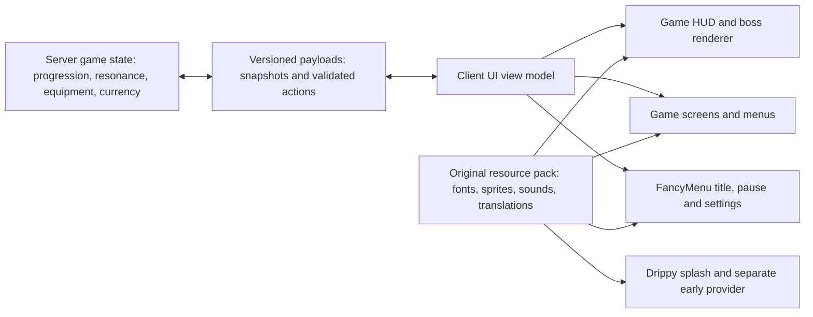

# Total-conversion UI research: Minecraft 1.21.1 + NeoForge

Research date: 2026-10-14 UTC. Scope: an original anime soulslike adventure, with Epic Fight 21.17.3.1 and the first two areas as the school milestone. This is a research report, not a tested mod implementation.

Evidence convention: **[V]** verified in a primary source (release metadata, original author's documentation, published source); **[C]** community/tutorial observation or user report; **[?]** proposed architecture, inference, unverified compatibility, or missing evidence. A verified author *claim* is distinguished from independently tested behavior. Code examples below are proposed examples using verified API names; they have not been compiled.

## 1. Decision for this project

- **[?] Recommended:** own the game's state, combat HUD, equipment/stats, checkpoint/shop/crafting replacement, dialogue, and death flow in the existing custom NeoForge mod. Use **FancyMenu + Drippy Loading Screen + Drippy Early Loading Module** for title/pause/settings presentation and both startup phases. Keep the actual artwork, fonts, UI sounds, fallback vanilla skin, and translations in an original resource pack. This follows the documented separation between menu state and screen rendering, named HUD layers, and Drippy's separate early provider. Sources: [NeoForge menus](https://docs.neoforged.net/docs/1.21.1/gui/menus/), [named layers](https://github.com/neoforged/NeoForge/blob/1.21.1/src/main/java/net/neoforged/neoforge/client/event/RegisterGuiLayersEvent.java), [Drippy Early](https://modrinth.com/mod/drippy-early-loading-module).
- **[V] A resource pack alone cannot accomplish arbitrary new inventory interaction or a new combat data model:** the extensibility points for those functions are Java `Screen`, menus, payloads, and the named layer API. Packs can supply their visual resources. **[?]** Consequently, treat resource-pack skinning as the asset layer, not the whole architecture. Sources: [screens](https://docs.neoforged.net/docs/1.21.1/gui/screens/), [payloads](https://docs.neoforged.net/docs/1.21.1/networking/payload/).
- **[V] Hiding Epic Fight's HUD does not require a blanket cancellation or, for its four standard overlays, a Mixin.** The exact 21.17.3.1 source JAR registers `epicfight:stamina_bar`, `epicfight:skills`, `epicfight:weapon_innate`, and `epicfight:charging_bar` as NeoForge named layers. See §4. Sources: [exact release](https://modrinth.com/mod/epic-fight/version/8HHhJt6i), [release API including source download](https://api.modrinth.com/v2/version/8HHhJt6i).
- **[V] KubeJS Painter examples are a version trap.** The official Painter page says the API was removed above 1.21. **[V]** A separate **PainterJS 1.2.0** release exists for **1.21.1 NeoForge**, but this is an additional mod, not a built-in feature of the chosen KubeJS. **[?]** Use scripting for content/progression and prototypes; use Java for the shipping, per-frame combat UI. Sources: [KubeJS Painter](https://kubejs.com/wiki/tutorials/painter-api), [PainterJS releases](https://www.curseforge.com/minecraft/mc-mods/painterjs/files/all).
- **[V] NeoForge's early loading screen is now skinnable through a separate Drippy module.** HoYoI's older primary documentation says its own startup screen does not cover NeoForge's early display; that is a limitation of HoYoI's implementation, not proof that every solution is impossible. Sources: [HoYoI README](https://github.com/DeeChael/HoYoI), [Drippy Early module](https://modrinth.com/mod/drippy-early-loading-module).
- **[?] No reviewed pack was established by installation/testing to replace every last surface in the request.** The strongest extensive-reskin examples are MC Story Mode: Perfect Pack, HoYoI's loading/pause screens, and Chinese server UI engines; their precise coverage and platform constraints are listed below. Do not equate a custom title menu with a complete conversion.

## 2. Exact 1.21.1 NeoForge releases and licenses

**[V] Method:** queried the official Modrinth project API and version API using both `game_versions=["1.21.1"]` and `loaders=["neoforge"]`, retaining the returned JSON in `ui_sources/`. These are the latest matching records returned at research time, unless stated otherwise. A filename containing `MC_1.21` is valid here when the version metadata explicitly includes 1.21.1. Version availability does **not** establish combined compatibility. [Modrinth API](https://docs.modrinth.com/api/).

| Mod / role | Exact matching release and artifact | Published / license | Source and recommendation |
|---|---|---|---|
| [V] FancyMenu | **3.9.14-1.21.1-neoforge**; `fancymenu_neoforge_3.9.14_MC_1.21.1.jar` | 2026-09-28; **DSMSLv3.1** | [release](https://modrinth.com/mod/fancymenu/version/P9dDosz2), [license](https://github.com/Keksuccino/FancyMenu/blob/master/LICENSE.md). Menu editor; requires Konkrete and Melody. |
| [V] Konkrete | **1.9.9-1.21-neoforge**; `konkrete_neoforge_1.9.9_MC_1.21.jar` | 2024-06-21; **Apache-2.0** | [release](https://modrinth.com/mod/konkrete/version/stJDU839). FancyMenu dependency. |
| [V] Melody | **1.0.10-1.21-neoforge**; `melody_neoforge_1.0.10_MC_1.21.jar` | 2024-06-21; **MIT** | [release](https://modrinth.com/mod/melody/version/efcdRVZP). FancyMenu audio dependency. |
| [V] Drippy Loading Screen | **3.1.5-1.21.1-neoforge**; `drippyloadingscreen_neoforge_3.1.5_MC_1.21.1.jar` | 2026-08-01; **DSMSLv3** | [release](https://modrinth.com/mod/drippy-loading-screen/version/MVgsDsSB), [license](https://github.com/Keksuccino/Drippy-Loading-Screen/blob/main/LICENSE.md). Requires FancyMenu, Konkrete, Melody. |
| [V] Drippy Early Loading Module | **3.1.5-1.21.1-neoforge**; `drippyloadingscreen-earlywindow_neoforge_3.1.5_MC_1.21.1.jar` | 2026-08-01; **DSMSLv3** | [release](https://modrinth.com/mod/drippy-early-loading-module/version/12xuEYZB). Separate dependency on Drippy; include deliberately for the early window. |
| [V] SpiffyHUD, formerly FancyHUD | **3.1.2-1.21.1-neoforge**; `spiffyhud_neoforge_3.1.2_MC_1.21.1.jar` | **DSMSLv3** | [release](https://modrinth.com/mod/spiffyhud/version/VbpgLRFa), [source/license](https://github.com/Keksuccino/SpiffyHUD). Requires FancyMenu and Konkrete; optional prototype/editor, not necessary when Java owns HUD. |
| [V] Modern UI | **3.13.0.1**; `ModernUI-NeoForge-1.21.1-3.13.0.1-universal.jar` | 2026-06-06; **LGPL-3.0-or-later** | [release](https://modrinth.com/mod/modern-ui/version/eMf1VSQd), [source](https://github.com/BloCamLimb/ModernUI-MC). Optional text engine; evaluate in a separate compatibility branch. |
| [V] Epic Fight, existing stack | **21.17.3.1-mc1.21.1-neoforge**; `epic-fight-21.17.3.1-mc1.21.1-neoforge.jar` | 2026-05-31; **GPL-3.0-or-later** in this project's metadata | [release and source artifact](https://modrinth.com/mod/epic-fight/version/8HHhJt6i). This report does not infer the license of other Minecraft branches. |
| [V] KubeJS, existing stack | **2101.7.2-build.377**; `kubejs-neoforge-2101.7.2-build.377.jar` | 2026-09-09; **LGPL-3.0-only** | [release](https://modrinth.com/mod/kubejs/version/THIGFPwf). Metadata requires Rhino and Architectury API. |
| [V] Rhino | **2101.2.8-build.91+Rhino-1.21**; `rhino-2101.2.8-build.91.jar` | **MPL-2.0** | [release](https://modrinth.com/mod/rhino/version/SqkDvOLG). KubeJS dependency. |
| [V] Architectury API | **13.0.11+neoforge**; `architectury-13.0.11-neoforge.jar` | **LGPL-3.0-only** | [release](https://modrinth.com/mod/architectury-api/version/1IiqEQGl). KubeJS dependency. |
| [V] Resource Pack Overrides | **v21.1.0-1.21.1-NeoForge**; `ResourcePackOverrides-v21.1.0-1.21.1-NeoForge.jar` | 2024-09-18; **MPL-2.0** | [release](https://modrinth.com/mod/resource-pack-overrides/version/xf3H2eJV), [source](https://github.com/Fuzss/resourcepackoverrides). Candidate for pack defaults/order; optional. |
| [V] Paxi | **1.21.1-NeoForge-5.1.3**; `Paxi-1.21.1-NeoForge-5.1.3.jar` | **LGPL-3.0-only** | [release](https://modrinth.com/mod/paxi/version/CLZfFbCx). Requires YUNG's API; alternative content-pack loading approach. |
| [V] YUNG's API | **1.21.1-NeoForge-5.1.9**; `YungsApi-1.21.1-NeoForge-5.1.9.jar` | **LGPL-3.0-only** | [release](https://modrinth.com/mod/yungs-api/version/2prKITKh). Only needed if choosing Paxi or another dependent mod. |
| [V] Polytone | **1.21-5.1.2**; `polytone-1.21-5.1.2-neoforge.jar` | 2026-10-13; **GPL-3.0-or-later** | [release](https://modrinth.com/mod/polytone/version/LIFh6A1Y), [source](https://github.com/MehVahdJukaar/polytone). Optional resource-pack extensions; no need merely to draw custom mod GUI. |
| [V] Cursors Extended / Minecraft Cursor | **3.11.3+1.21.1**; `minecraft-cursor-neoforge-3.11.3+1.21.1.jar` | **MIT** | [release](https://modrinth.com/mod/minecraft-cursor/version/hOGb4sKV), [source](https://github.com/fishstiz/cursors_extended). Optional; choose one cursor owner instead of stacking with FancyMenu's cursor element. |
| [V] Legendary Tooltips | **1.5.5**; `LegendaryTooltips-1.21.1-neoforge-1.5.5.jar` | 2025-04-08; **CC-BY-NC-ND-4.0** | [release](https://modrinth.com/mod/legendary-tooltips/version/BabRJO04). Requires Iceberg and a Prism project; optional alternative to own tooltip renderer. |
| [V] Iceberg | **1.3.2**; `Iceberg-1.21.1-neoforge-1.3.2.jar` | 2025-04-14; **CC-BY-NC-ND-4.0** | [release](https://modrinth.com/mod/iceberg/version/IMssx9du). Dependency, not a UI conversion by itself. |
| [V] Prism (`prism-lib`) | **1.0.11**; `Prism-1.21.1-neoforge-1.0.11.jar` | **CC-BY-NC-ND-4.0** | [release](https://modrinth.com/mod/prism-lib/version/kMcz2lDj). Actual Legendary Tooltips dependency; distinguish from unrelated projects named Prism. |
| [V] Blur+ | **6.3.1+1.21.1-neoforge**; `blur-neoforge-6.3.1+1.21.1.jar` | 2026-06-29; **MIT** | [release](https://modrinth.com/mod/blur-plus/version/xONakKZi). Optional; metadata requires **MidnightLib** (`codAaoxh`, MIT). Avoid adding another blur system before measuring the baseline. |
| [V] MidnightLib | **1.9.3+1.21.1-neoforge**; `midnightlib-neoforge-1.9.3+1.21.1.jar` | **MIT** | [release](https://modrinth.com/mod/midnightlib/version/6Gv5jvTB). Blur+ dependency. |
| [V] PainterJS | **1.2.0**, MC **1.21.1 NeoForge** | 2026-02-17; **LGPLv3** as listed on CurseForge | [official files](https://www.curseforge.com/minecraft/mc-mods/painterjs/files/all). Modrinth slug `painterjs` was not found; do not guess a JAR filename or API signature. |

**[V] Loader reference:** the official Maven metadata returned **21.1.259** as the last stable `21.1.*` entry during this research. **[?]** This is a reference for reproducing current API research, not a request to change an already pinned game instance. API source links below refer to the maintained `1.21.1` branch; archive/pin its commit when implementation begins. [Official Maven metadata](https://maven.neoforged.net/releases/net/neoforged/neoforge/maven-metadata.xml).

### License implications that matter to distribution

- **[V] FancyMenu's current DSMSLv3.1 permits pack/dependency references to official downloads, but forbids shipping the mod JAR directly inside pack files or redistributing compiled forks without permission.** It permits addons that depend on it without embedding its implementation. **[?]** Ship the official mod reference in a manifest and the project's own layouts/assets in overrides. Source: [actual license text](https://github.com/Keksuccino/FancyMenu/blob/master/LICENSE.md).
- **[V] Drippy/Spiffy have their own DSMSLv3 texts; they are not Apache/MIT just because their dependencies are.** Preserve the per-project license distinction. Sources: [Drippy license](https://github.com/Keksuccino/Drippy-Loading-Screen/blob/main/LICENSE.md), [Spiffy license](https://github.com/Keksuccino/SpiffyHUD/blob/main/LICENSE.md).
- **[V] Legendary Tooltips, Iceberg, and its actual Prism dependency (`prism-lib`, project `1OE8wbN0`) metadata state NC/ND terms; source visibility is not permission to distribute a modified version.** **[?]** Since the project already needs custom tooltips, an original renderer reduces this dependency/licensing burden. Sources: [Legendary project API](https://api.modrinth.com/v2/project/legendary-tooltips), [Iceberg project API](https://api.modrinth.com/v2/project/iceberg), [Prism project API](https://api.modrinth.com/v2/project/prism-lib).
- **[?] Keep a third-party inventory by exact artifact, source URL, and license.** The project's original artwork/music is separate from mod-code permissions. An MIT label on pack metadata is not a blanket license for every font, soundtrack, illustration, or dependency inside that pack; inspect each asset's origin.

## 3. Chinese, Japanese, and Korean material worth reading

### 3.1 Chinese sources: practical workflows and overlooked engines

| Source | What is actually established | Transfer to the project |
|---|---|---|
| [V] Bilibili, 吕不才, **『Fancy Menu 教程』#03 怎么制作背景动画**, 2022-12-09 | Original video-page description links the creator's tools and animation workflow. [video](https://www.bilibili.com/video/BV1Zg411J7Fu/) | [?] Historical animation tutorial, not proof of current v3 configuration syntax. Use the concept and original animations. |
| [V] Bilibili, 辣某人, **给你的MC添加进入动画**, 2023-07-08 | The page itself explicitly warns the tutorial uses **2.x** after a major update. Lists Konkrete, FancyMenu, Load My Resources, and cave-animation assets. [video](https://www.bilibili.com/video/BV1N8411D7wm/) | [?] Useful visual/editor introduction; do not carry the old dependency set into 3.9.14. Current release metadata establishes Konkrete + Melody. |
| [C] MC百科 **FM使用教程** | Explains enabling a screen layout, anchors, dragging elements, and adding image/GIF/audio assets. [tutorial](https://www.mcmod.cn/post/2642.html) | [?] Good Chinese entry point. Anchor-based layout survives resizing better than copying screenshot coordinates. Confirm menus against current official docs. |
| [C] MC百科 **使用视频作为背景** | Uses **1.21.1 Fabric**, MP4, MCEF, and `config/fancymenu/assets`. [tutorial](https://www.mcmod.cn/post/5891.html) | [?] Not verified for NeoForge or current FancyMenu. Current official docs expose browser media through **Rinku**. Use static/parallax art or an image sequence first. |
| [C] MC百科 **Spiffy HUD / FancyHUD** | Lists NeoForge 1.21.1 and HUD replacement/editor use; includes older FancyHUD license/dependency descriptions. [entry](https://www.mcmod.cn/class/4352.html) | [V] Current author changelog says v3 is a complete rewrite and FancyMenu addon. Prefer exact v3 release metadata to stale portions of the encyclopedia. [changelog](https://github.com/Keksuccino/SpiffyHUD/blob/main/changelog.txt) |
| [V] BloCamLimb on MC百科, **如何更改字体、创建字体？如何使用原版字体？我字咋不渲染？** | Original mod-author explanation of JSON font providers and differences in Modern UI's font engine. It documents different handling of `size`, `oversample`, `shift`, `skip`. [article](https://www.mcmod.cn/post/3542.html) | [?] Best Chinese technical font lead; do not assume a font JSON calibrated for vanilla keeps identical metrics with Modern UI. |
| [C] MC百科 **元谋人都看得懂的字体设置教程** | Demonstrates Modern UI GUI font selection and documents relative-path/system-font pitfalls. [tutorial](https://www.mcmod.cn/post/5496.html) | [?] Test bundled resource fonts on a clean machine, not just the developer's installed Windows fonts. |
| [V] Flandre923 original tutorial source; [C] CryChic's Chinese presentation | The published **1.20.4** HUD example uses `IGuiOverlay`, `ExtendedGui`, and `RegisterGuiOverlaysEvent`. [source](https://github.com/Flandre923/NeoForgeTutorialmod-Minecraft1.20.4), [Chinese HUD page](https://docs.mihono.cn/zh/develop/modding/1.20.4/Neoforge/flandre/out_38_HUD) | [V] This API differs from the verified 1.21.1 `LayeredDraw.Layer` / `RegisterGuiLayersEvent`. Read for drawing concepts, migrate names and signatures. |
| [C] duoduo70, **Neoforged 事件列表的中文翻译** | Chinese event-name index includes render layer, tooltip, screen, and key events. [repository](https://github.com/duoduo70/Neoforged-Events-List-Chinese) | [?] Useful navigation aid; actual cancellation rules/buses come from NeoForge source. |
| [C] Mouse0w0, **我的世界开发者中文指南** | Index links both DimLoong's 1.21.1 Chinese docs and xiaopiao's AI translation, plus MCBBS archival resources. [index](https://github.com/Mouse0w0/MinecraftDeveloperGuide) | [?] Start with the versioned translated docs, then verify sensitive signatures in original source. One translated page failed retrieval in this run. |
| [V] **PaiUI**, original developer listing, Chinese | Seller advertises HTML/CSS/JS replacement of inventory, ESC, death, HUD, Tab and world panels. Its platform table explicitly includes **1.21.1 NeoForge** client support; server integrations listed are Bukkit/Spigot/Paper/Folia. It is closed/paid, with no open-source license. [developer listing](https://www.himcbbs.com/resources/1472/), [updated listing](https://www.minebbs.com/resources/paiui.16037/) | [?] Strong overlooked architectural comparison, **not** verified as a drop-in single-player NeoForge solution. Listing version `1.0.0`; updated-page reviews mention `V1.3.2132`, but no inspected binary/build pin. Browser/native memory cost and Epic Fight integration unknown. |
| [V] **MistInteract**, author's listing | Chinese original dialogue plugin uses ArcartX HUDs, keyboard/scroll selection, branched dialogue and vanilla/additional HUD hiding. [listing](https://www.minebbs.com/resources/mistinteract-ui-npc.16182/) | [?] Reuse the interaction pattern, not the plugin stack: page contains mixed 1.20/1.21 support labels and says server-side 1.20.1. No verified NeoForge 1.21.1 artifact. |
| [C] MC百科 **HoYoI** and **原的世界 / Genshin Craft** | Useful discoveries of anime-game UI implementations rather than generic dark-mode packs. [HoYoI entry](https://www.mcmod.cn/class/15299.html), [Genshin Craft entry](https://www.mcmod.cn/class/12041.html) | [V] HoYoI's author confirms Genshin-style loading/pause, with Star Rail still WIP. [source](https://github.com/DeeChael/HoYoI). [?] Encyclopedia NeoForge support for Genshin Craft requires independent artifact verification. |

**[V] Bilibili access limitation:** indexed video-page descriptions were available through built-in search, but direct page opening failed for the animation tutorial; two public video-info API requests returned HTTP **412**, preventing comment retrieval. **[?]** No Bilibili comment is asserted or quoted in this report. The accessible page's own 2.x warning is stronger than inventing comment-level compatibility advice. Tested endpoints: [video info #03](https://api.bilibili.com/x/web-interface/view?bvid=BV1Zg411J7Fu), [video info entrance animation](https://api.bilibili.com/x/web-interface/view?bvid=BV1N8411D7wm).

### 3.2 Japanese sources: modpack editing, custom fonts, title-based UI

- **[V] スティーブ, “Minecraft Modpack作りのすゝめ #FancyMenu編1” (2024-10-05):** original Japanese walkthrough puts image/BGM files in `config/fancymenu/assets`, enables screen customization, and creates a current-screen layout. **[?]** Practical Japanese editor onboarding; use current docs for changing labels and feature details. [Original Japanese](https://note.com/suthi_bumodder/n/n5b68414214c9).
- **[V] ボイやん, FancyMenu introduction with Japanese translation pack (2024-12-20):** covers button/label/font, animation, and menu music customization and supplies a Japanese localization ZIP. **[?]** It does not establish total vanilla UI coverage. [Original Japanese](https://note.com/voyager1564/n/nc47a9eec3ba8). **[V]** The same note page appears in Korean through `?hl=ko`; that is an AI-translated Japanese page, not independent Korean research evidence. [Translated page](https://note.com/voyager1564/n/nc47a9eec3ba8?hl=ko).
- **[V] Nakanishi, original Forge 1.20.1 Java GUI course:** teaches `AbstractContainerScreen`/`GuiGraphics` and the distinction between Menu's state and Screen's appearance. **[?]** Good Japanese conceptual course, but its `FMLClientSetupEvent` registration example should not displace the verified NeoForge 1.21.1 `RegisterMenuScreensEvent`. [Author's course](https://kazushinakanishi.hatenablog.jp/), [NeoForge registration](https://docs.neoforged.net/docs/1.21.1/gui/screens/#registering-an-abstractcontainerscreen).
- **[V] Yuru-Yurufu, “titleコマンドで、最高にアツいGUIを作ろう”:** original Japanese experiment uses font `space` advances, bitmap/title graphics, and text core-shader repositioning. It explicitly discusses screen-size anchoring problems. **[?]** Excellent demonstration of how font glyphs become UI; avoid the shader mutation route for the baseline Iris-enabled client. [Qiita article](https://qiita.com/Yuru-Yurufu/items/09b949cce51d84bce4f4).
- **[V] かげな, Java font article:** demonstrates **MisakiGothic2forMC** and Modern UI as two approaches. **[?]** The article's “mod-free” discussion is historical; do not inherit its old compatibility assumptions. [Article](https://note.com/harujun214/n/n9ebcf7f125a1).
- **[C] Japanese DawnCraft guide:** reports subtitle overlap with Epic Fight UI. **[?]** The correct project lesson is to reserve subtitle space and redesign layout, not automatically remove accessibility subtitles. [Guide](https://www.mpo-gg.com/2023/10/minecraft-modpack-dawncraft.html).
- **[C] DQM5 Japanese wiki:** reports extensive always-visible GUI redesign with selectable old GUI. **[?]** This is a historical RPG-interface precedent, not a verified 1.21.1 dependency or complete title/death/settings conversion. [Wiki](https://wikiwiki.jp/mc-dqm5/).
- **[V] BOOTH, エイ's “被虐のノエル” Java resource pack:** an original uploader documents an anime/indie-game-themed pack and explicitly says it did not work in 1.20.5. **[?]** A useful counterexample to “latest version compatible” marketing; do not import its artwork/music or assume 1.21.1 portability. [Listing](https://booth.pm/ja/items/4883468).

### 3.3 Korean sources: genuine development reports and reusable font work

- **[C] DC Inside / 스티브 gallery, 파란이, “UI 만들기” (2026-07-04):** developer describes replacing KubeJS UI rendering with directly coded mod rendering and claims roughly tenfold FPS improvement plus lower server load. **[?]** There is no reproducible benchmark or pinned NeoForge build in the inspected article; do not turn this into a performance guarantee. It supports investigating Java-owned rendering. [Original Korean post](https://gall.dcinside.com/mgallery/board/view/?id=steve&no=383515).
- **[V] Korean BetterHud project:** toxicity188's MIT repository implements **server-side** HUDs, generates packs, and displays image sequences/text/heads with animation. Current README targets Bukkit/Folia, Velocity, and Fabric server. **[V]** The official Modrinth `betterhud2` query returned **no 1.21.1 NeoForge** release. **[?]** Study its data-driven layouts/asset generation; do not install the Bukkit plugin into a NeoForge instance. [Author's repository](https://github.com/toxicity188/BetterHud), [project API](https://api.modrinth.com/v2/project/betterhud2).
- **[V] oruur/bhf4mc, “마인크래프트 1.2x 한글 폰트 리소스팩”:** author's own Hangul resources and generation code are MIT; README discusses forced-Unicode affecting the Latin face. **[?]** Inspect and migrate its exact font JSON to 1.21.1 rather than assuming all historical generated packs work unchanged. [Primary repository](https://github.com/oruur/bhf4mc).
- **[V] AndyH0ng/minecraft-galmuri:** author's pack replaces Korean type with Galmuri-9 and documents normal pack installation. **[?]** The inspected README provides no explicit tested 1.21.1 range. [Repository](https://github.com/AndyH0ng/minecraft-galmuri).
- **[V] quiple's Galmuri:** genuine Korean font project, distributed under **OFL-1.1**, with pixel-styled TTF variants. **[?]** Good secondary option for a pixel UI; the main cinematic/anime interface should test readable outline text first. [Font author](https://github.com/quiple/galmuri), [license](https://github.com/quiple/galmuri/blob/main/ofl.md).
- **[V] Pretendard:** author's Korean documentation provides a multilingual outline family and OFL terms. **[?]** A strong candidate for Korean body text/headings; use a bundled static font, measure font coverage and layout before making it the pack default. [Original project](https://github.com/orioncactus/pretendard).
- **[V] Seres Online's own Korean site advertises custom HUD/GUI and automatic server packs.** **[?]** This demonstrates the local market's standalone-RPG goal, but the page does not expose a NeoForge 1.21.1 implementation or a complete screen audit. [Operator's site](https://seresonline.co.kr/).

### 3.4 Coverage honesty

**[?] Search coverage limitation:** narrow searches of Tieba, NGA, Zhihu, Arca Live, Ruliweb, direct namu.wiki, Pixiv, Fanbox, Nicovideo, and Japanese X did not produce source-level, version-specific evidence suitable for a conclusion here. This is not evidence that relevant projects do not exist. Naver Cafe access was explicitly robots-blocked. Korean namu mirrors found resource-pack/Bedrock HUD-command material, but were not used as Java/NeoForge API authority. MCBBS archive links were discovered through the Chinese developer index; the modern, authoritative API evidence came from published NeoForge source. No fabricated forum/comment consensus is reported.

**[?] Search-language lesson:** exclude Bedrock's JSON UI/OreUI, Paper-only server plugins, and launcher UI from the Java NeoForge implementation bucket. A Korean-translated Japanese note or localized 9Minecraft page is not proof of Korean mod-dev practice. Technical conclusions below use upstream documentation/source; community observations remain [C].

## 4. Concrete NeoForge 1.21.1 APIs and Epic Fight integration

### 4.1 Named HUD layers: correct event, signature, and bus

**[V] Registration:** `net.neoforged.neoforge.client.event.RegisterGuiLayersEvent` is a client-only **mod-bus** event. Its callbacks are `LayeredDraw.Layer`, rendered with **`GuiGraphics, DeltaTracker`**, not the older `IGuiOverlay(ExtendedGui, float, width, height)` signature. It exposes `registerAbove`, `registerBelow`, `registerAboveAll`, `registerBelowAll`; the current 1.21.1 branch also has `replaceLayer` and `wrapLayer`. Registration docs explicitly advise ordering against vanilla or your own layers, not another mod's layer. [Primary source](https://github.com/neoforged/NeoForge/blob/1.21.1/src/main/java/net/neoforged/neoforge/client/event/RegisterGuiLayersEvent.java).

**[V] Suppression:** `RenderGuiLayerEvent.Pre` is cancellable on **`NeoForge.EVENT_BUS`**, the game/main bus. `getName()` supplies the resource ID; `setCanceled(true)` prevents that layer's render and its matching `Post`. `Post` is not cancellable. A layer event can still fire when its built-in visibility predicate would skip drawing. [Primary source](https://github.com/neoforged/NeoForge/blob/1.21.1/src/main/java/net/neoforged/neoforge/client/event/RenderGuiLayerEvent.java).

**[V] Exact vanilla layer identifiers are constants in `VanillaGuiLayers`:**

| Replacement group | Constants to audit / suppress |
|---|---|
| [V] Core combat | `CROSSHAIR`, `HOTBAR`, `PLAYER_HEALTH`, `ARMOR_LEVEL`, `FOOD_LEVEL`, `EXPERIENCE_BAR`, `EXPERIENCE_LEVEL`, `SELECTED_ITEM_NAME` |
| [V] Other status | `AIR_LEVEL`, `VEHICLE_HEALTH`, `JUMP_METER`, `EFFECTS`, `BOSS_OVERLAY` |
| [V] Text / multiplayer | `OVERLAY_MESSAGE`, `TITLE`, `CHAT`, `TAB_LIST`, `SCOREBOARD_SIDEBAR`, `SPECTATOR_TOOLTIP` |
| [V] Miscellaneous | `CAMERA_OVERLAYS`, `SLEEP_OVERLAY`, `DEMO_OVERLAY`, `DEBUG_OVERLAY`, `SUBTITLE_OVERLAY`, `SAVING_INDICATOR` |

Source for all rows: [NeoForge VanillaGuiLayers.java](https://github.com/neoforged/NeoForge/blob/1.21.1/src/main/java/net/neoforged/neoforge/client/gui/VanillaGuiLayers.java).

**[?] Suppress only what has a replacement or is intentionally absent from the game rules.** Water air/poison effects need a readable signal if they can affect the player. Keep developer debug information in a development mode and provide subtitles/save feedback in the game's visual language. Do not cancel `RenderGuiEvent.Pre` globally just to remove hearts: that skips the entire layer manager and your own registered HUD as well. **[V]** The layer manager returns immediately when this whole-GUI pre-event is cancelled. [Manager source](https://github.com/neoforged/NeoForge/blob/1.21.1/src/main/java/net/neoforged/neoforge/client/gui/GuiLayerManager.java).

**[?] Implementation sketch — API names verified, example not compiled.** Bind the first handler to the client mod bus and the second to the game bus; restrict loading these classes to `Dist.CLIENT`. `GameUiMode.active()` is a proposed project helper, not a NeoForge API.

```java
// Imports omitted; bind to the CLIENT mod event bus.
static void registerHud(RegisterGuiLayersEvent event) {
    event.registerAboveAll(
        ResourceLocation.fromNamespaceAndPath("garden", "combat_hud"),
        (graphics, delta) -> {
            Minecraft mc = Minecraft.getInstance();
            if (!GameUiMode.active() || mc.player == null ||
                mc.options.hideGui || mc.player.isSpectator()) return;
            float partial = delta.getGameTimeDeltaPartialTick(false);
            GameHud.draw(graphics, partial);  // proposed project renderer
        });
}

// Bind to NeoForge.EVENT_BUS on the client.
static final Set<ResourceLocation> HIDDEN = Set.of(
    VanillaGuiLayers.HOTBAR,
    VanillaGuiLayers.PLAYER_HEALTH,
    VanillaGuiLayers.ARMOR_LEVEL,
    VanillaGuiLayers.FOOD_LEVEL,
    VanillaGuiLayers.EXPERIENCE_BAR,
    VanillaGuiLayers.EXPERIENCE_LEVEL,
    VanillaGuiLayers.SELECTED_ITEM_NAME,
    ResourceLocation.parse("epicfight:stamina_bar"),
    ResourceLocation.parse("epicfight:skills"),
    ResourceLocation.parse("epicfight:weapon_innate"),
    ResourceLocation.parse("epicfight:charging_bar")
);

static void suppressHud(RenderGuiLayerEvent.Pre event) {
    if (GameUiMode.active() && HIDDEN.contains(event.getName())) {
        event.setCanceled(true);
    }
}
```

**[V] Why the explicit F1 guard matters:** custom layers added through registration are not automatically wrapped in every vanilla conditional layer group's visibility predicate. The manager flattens vanilla child groups with their predicates and separately dispatches registered layers. **[?]** Explicitly honor `options.hideGui`, cutscene state, world availability, and spectator/death policy. [Manager source](https://github.com/neoforged/NeoForge/blob/1.21.1/src/main/java/net/neoforged/neoforge/client/gui/GuiLayerManager.java).

### 4.2 Epic Fight 21.17.3.1: verified details, not guesses from 1.20 videos

**[V] Source inspection:** downloaded the official source artifact associated with release `8HHhJt6i`. The file `yesman/epicfight/client/platform/neoforge/event/ClientModBusEvent.java` registers four overlays:

| [V] Layer ID | Renderer |
|---|---|
| `epicfight:stamina_bar` | `BattleModeGui.renderStaminaBar` |
| `epicfight:skills` | `BattleModeGui.renderNormalSkills` |
| `epicfight:weapon_innate` | `BattleModeGui.renderWeaponInnateSkill` |
| `epicfight:charging_bar` | `BattleModeGui.renderChargingBar` |

Primary provenance for these and the next details: [official release API](https://api.modrinth.com/v2/version/8HHhJt6i), [release/source download page](https://modrinth.com/mod/epic-fight/version/8HHhJt6i). The extracted originals are under `ui_sources/epic_*`.

- **[V] World-space entity UI is a separate path:** `RenderEngine` draws `EntityUI.ENTITY_UI_LIST` in living-entity rendering when GUI is visible and the `disableEntityUI` rule is false. Cancelling screen HUD layers does not hide those entity indicators. The exact source defines `/gamerule disableEntityUI true`; this removes all Epic Fight entity UI, not merely a screen bar. [Exact source artifact provenance](https://api.modrinth.com/v2/version/8HHhJt6i).
- **[V] Selective client settings:** `ingame.health_bar_show_option` has enum value **`NONE`**; `ingame.show_target_indicator` and `ingame.enable_target_entity_guide` are booleans. **[?]** Disable existing world health/target art only when supplying the desired replacement; preserve lock-on logic independently. [Exact source artifact provenance](https://api.modrinth.com/v2/version/8HHhJt6i).
- **[V] Tooltip cleanup:** `ingame.show_epicfight_attributes` controls Epic Fight attributes added to tooltips. **[?]** Turn off this stock presentation if equipment stats are rendered in a custom panel; do not remove the underlying combat attributes. [Exact source artifact provenance](https://api.modrinth.com/v2/version/8HHhJt6i).
- **[V] `BattleModeGui` reads stamina through `EpicFightCapabilities.getCachedLocalPlayerPatch()` and `getStamina()/getMaxStamina()`; `getSkill(slot)` returns skill containers.** **[?]** If custom skill charge icons are needed, write an adapter to the pinned source, then render your own cached view model. Hiding stamina is separate from disabling its gameplay costs. The project requires a resonance mechanic, not a cosmetic relabeling of Epic Fight stamina. [Exact source artifact provenance](https://api.modrinth.com/v2/version/8HHhJt6i).
- **[?] Do not invent `hideAllHud=true` or move the bars off-screen as the final solution.** Cancel the known named overlays, configure entity UI, and audit every installed addon for separately registered/rendered UI. A Mixin should be a narrowly scoped fallback only for a surface without an appropriate event.

### 4.3 Screens, inventories, tooltips, sounds

| API / verified behavior | Proposed project use |
|---|---|
| [V] `ScreenEvent.Opening` on the game bus exposes `getCurrentScreen()`, `getNewScreen()`, and `setNewScreen(...)`; cancellable. [source](https://github.com/neoforged/NeoForge/blob/1.21.1/src/main/java/net/neoforged/neoforge/client/event/ScreenEvent.java) | [?] Route known vanilla title/pause/death/inventory screens to game equivalents, with explicit guards and no recursive `setScreen()` inside the opening listener. |
| [V] `ScreenEvent.Init.Pre/Post`, render/input subclasses, and widget add/remove hooks live in the same event source. [source](https://github.com/neoforged/NeoForge/blob/1.21.1/src/main/java/net/neoforged/neoforge/client/event/ScreenEvent.java) | [?] Decorate ordinary settings or remove obsolete controls; avoid cancelling every screen wholesale. |
| [V] `RegisterMenuScreensEvent.register(menuType, factory)` runs on client mod bus. [source](https://github.com/neoforged/NeoForge/blob/1.21.1/src/main/java/net/neoforged/neoforge/client/event/RegisterMenuScreensEvent.java) | [?] Bind EquipmentMenu/CheckpointMenu/UpgradeMenu to their custom screens. |
| [V] `AbstractContainerMenu` owns slots/state; `AbstractContainerScreen` renders/handles client interaction. [menus](https://docs.neoforged.net/docs/1.21.1/gui/menus/) | [?] Preserve container IDs, slot mapping, validity, quick-move rules and close handling. Replacing a background PNG cannot rearrange actual slot hitboxes. |
| [V] `RenderTooltipEvent.GatherComponents`, `.Pre`, `.Color` support component gathering, cancellation/position/font, and background/border colors respectively. [source](https://github.com/neoforged/NeoForge/blob/1.21.1/src/main/java/net/neoforged/neoforge/client/event/RenderTooltipEvent.java) | [?] Custom stats panels, icon rows, colored rarity borders. For shaped/image backgrounds, use own renderer rather than assuming `.Color` changes tooltip geometry. |
| [V] `CustomizeGuiOverlayEvent.BossEventProgress` is cancellable, exposes the boss event and draw origin, and allows changing the stacking increment. [source](https://github.com/neoforged/NeoForge/blob/1.21.1/src/main/java/net/neoforged/neoforge/client/event/CustomizeGuiOverlayEvent.java) | [?] Replace each received boss bar while retaining its state, or suppress `BOSS_OVERLAY` and use a dedicated boss snapshot including phase/resonance. Choose one owner. |
| [V] `PlaySoundEvent` is under **`client.event.sound`**; `setSound(null)` prevents sound, `setSound(newInstance)` replaces it. It is **not cancellable**. [source](https://github.com/neoforged/NeoForge/blob/1.21.1/src/main/java/net/neoforged/neoforge/client/event/sound/PlaySoundEvent.java) | [?] Context-specific UI/menu-music suppression. Resource overrides are simpler when every use of an event should change. |
| [V] `RegisterClientReloadListenersEvent.registerReloadListener(...)` supports registering client resource reload listeners. [source](https://github.com/neoforged/NeoForge/blob/1.21.1/src/main/java/net/neoforged/neoforge/client/event/RegisterClientReloadListenersEvent.java) | [?] Load/validate own theme definitions, cache text metrics/assets, and rebuild safely on F3+T. |

**[V] Data synchronization on this version:** NeoForge 1.21.1 attachments do **not** automatically synchronize to clients; use payloads. Entity attachments are not copied on player death by default; `copyOnDeath` or `PlayerEvent.Clone` implements the policy. **[?]** Apply currency loss once on the authoritative server, copy persistent progression, then send the new snapshot on respawn. [Versioned attachment docs](https://docs.neoforged.net/docs/1.21.1/datastorage/attachments/).

**[V] Concrete network API:** `RegisterPayloadHandlersEvent` provides `event.registrar("1")`; `playToClient`, `playToServer`, `CustomPacketPayload`, `StreamCodec`, and `PacketDistributor.sendToPlayer/sendToServer` provide the client/server bridge. Default handlers run on the main thread. **[?]** Send semantic commands and state snapshots, not UI pixels or trusted client currency values. [Versioned payload docs](https://docs.neoforged.net/docs/1.21.1/networking/payload/).

**[V] Small correction to common Forge tutorials:** vanilla `DataSlot` descriptions warn about 16-bit transmission, but the NeoForge 1.21.1 documentation explicitly says NeoForge patches the packet to transmit the full integer. **[?]** Still use custom payloads for long currency values, structured equipment records and composite boss/resonance data rather than awkward int splitting. [NeoForge menu note](https://docs.neoforged.net/docs/1.21.1/gui/menus/).

## 5. Fonts, resource-pack UI tricks, and CJK portability

### 5.1 What the exact Minecraft 1.21.1 files establish

**[V] Direct primary inspection:** obtained 1.21.1 metadata through Mojang's official version manifest, downloaded its official client JAR, and enumerated 509 GUI/font entries. Original metadata and the path inventory are retained in `ui_sources/`. [Mojang manifest](https://piston-meta.mojang.com/mc/game/version_manifest_v2.json), [exact 1.21.1 client artifact](https://piston-data.mojang.com/v1/objects/30c73b1c5da787909b2f73340419fdf13b9def88/client.jar).

- **[V] HUD sprites are split files**, e.g. `assets/minecraft/textures/gui/sprites/hud/hotbar.png`, `hotbar_selection.png`, `experience_bar_background.png`, `experience_bar_progress.png`, `heart/full.png`, and `food_full.png`. Boss bars are under `textures/gui/sprites/boss_bar/`; inventory's background remains `textures/gui/container/inventory.png`. The GUI atlas collects `gui/sprites`. **[?]** Old advice to edit just `gui/icons.png` or `widgets.png` misses these paths. Source: exact Mojang client artifact above.
- **[V] `assets/minecraft/font/default.json` references** `minecraft:include/space`, `minecraft:include/default` (with `filter: {"uniform": false}`), and `minecraft:include/unifont`. `uniform.json` references space and unifont. **[?]** Check both default and forced-Unicode paths; overriding only the Latin bitmap is not a complete Korean/Japanese/Chinese font replacement. Source: exact Mojang client artifact above.
- **[V] Some font content comes from external indexed assets:** the client JAR's `include/unifont.json` is an empty provider stub, while the matching asset-index download contains the real `unihex` provider using `minecraft:font/unifont_jp.zip` and size overrides. **[?]** Inspect the asset index as well as the JAR when diagnosing missing CJK glyphs. This avoids treating an empty JAR stub as the actual runtime font. Source: [exact Mojang font definition](https://resources.download.minecraft.net/f4/f40266672fa6cd5c678cbfd5a7fdcfe06e30c629), selected by the [official asset index](https://piston-meta.mojang.com/v1/packages/15200809663f45954c2c9a33ce88849e61aaaecc/17.json).
- **[V] Resource pack format is 34 for 1.21.** **[?]** Use 34 for this 1.21.1 asset pack and verify acceptance in the pinned instance. The data-pack format is a separate number. [Mojang release notes](https://www.minecraft.net/en-us/article/minecraft-java-edition-1-21).

### 5.2 Three font layers, each with a clear job

**[?] Proposed namespaces:** `garden:body` for readable localized text, `garden:display` for original headings, and `garden:icons` for private-use pictograms. Use original textures for icons. Give critical numeric gauges ordinary text/draw calls so a missing glyph cannot hide the health value. For bilingual/CJK screens, fit text using the actual `Font.width`/wrapped metrics; do not position by character count.

**[V] Resource-font identifiers follow `assets/<namespace>/font/<name>.json`; bitmap provider textures use a path under `textures/`, TTF files under `font/`. Modern UI's author also documents the vanilla JSON provider schema.** [Author's font explanation](https://www.mcmod.cn/post/3542.html).

**[?] Illustrative vanilla TTF definition**, `assets/garden/font/body.json`, with the actual, licensed static TTF at `assets/garden/font/body.ttf`. It requires real-font testing; these are starting metrics, not verified optimal settings:

```json
{
  "providers": [
    {
      "type": "ttf",
      "file": "garden:body.ttf",
      "size": 11,
      "oversample": 2,
      "shift": [0, 0]
    },
    { "type": "reference", "id": "minecraft:include/unifont" }
  ]
}
```

**[?] Draw game-owned text with a `Component` style selecting `garden:body`; put a reference to this font into both `assets/minecraft/font/default.json` and `uniform.json` if the goal includes global vanilla/mod text replacement.** Preserve a fallback. Test precedence after merging with other packs; do not introduce a recursive reference from `garden:body` back to a replaced `minecraft:default`. Supporting an outline file in Modern UI does not prove vanilla's TTF backend accepts every OTF/TTC/variable font; use a tested static TrueType file for the baseline.

**[?] Illustrative icon + negative-spacing definition**, `assets/garden/font/icons.json`; texture `assets/garden/textures/font/ui_icons.png` contains two equal cells:

```json
{
  "providers": [
    {
      "type": "bitmap",
      "file": "garden:font/ui_icons.png",
      "ascent": 12,
      "height": 16,
      "chars": ["\uE001\uE002"]
    },
    {
      "type": "space",
      "advances": { "\uE100": -16, "\uE101": 4 }
    }
  ]
}
```

**[V] Negative Space Font demonstrates positive/negative advance glyphs and translation-key offsets**, making it possible to overlap bitmap images and shift text without visible spaces. Its license is **CC-BY-4.0**. **[?]** Use the trick for chat/tutorial/title pictograms; use direct `GuiGraphics` for continuously animated combat bars and interactive inventory panels. [Author's source](https://github.com/AmberWat/NegativeSpaceFont).

**[V] Japanese title-GUI experiments show that custom font images can be moved into HUD-like placements through text core-shader changes.** **[?]** On the planned Sodium/Iris client, prefer Java anchors over changing `rendertype_text.vsh`: compatibility and shader-version behavior are not established by those experiments. [Japanese original](https://qiita.com/Yuru-Yurufu/items/09b949cce51d84bce4f4).

### 5.3 Recommended CJK candidates and real compatibility limits

| Candidate | Verified provenance / license | Proposed role and unresolved details |
|---|---|---|
| [V] **Pretendard**, Korean | [author repository](https://github.com/orioncactus/pretendard), **OFL-1.1** | [?] First Korean outline UI trial. Use actual static desktop TTF, not CSS/WOFF; test full Hangul and Latin punctuation/numbers. |
| [V] **BIZ UDGothic / BIZ UDPGothic**, Japanese | [Morisawa/Google project](https://github.com/googlefonts/morisawa-biz-ud-gothic), **OFL-1.1** | [?] Readability-focused Japanese alternative; compare proportional and fixed-width metrics. Do not assume Japanese glyph shapes are appropriate for every Chinese locale. |
| [V] **Source Han Sans**, multilingual CJK | [Adobe project](https://github.com/adobe-fonts/source-han-sans), **OFL-1.1**; also credited in [Modern UI](https://github.com/BloCamLimb/ModernUI-MC) | [?] Broad CJK coverage/fallback, especially with Modern UI; select locale-specific face, compatible format and weight. Large font files need memory/reload measurement. |
| [V] **LXGW WenKai / 霞鹜文楷**, Chinese | [font author's repository](https://github.com/lxgw/LxgwWenKai), **OFL-1.1** | [?] Optional readable narrative flavor; less suitable as the only small combat-number font. Test static TTF and actual script coverage. |
| [V] **Galmuri**, Korean pixel style | [author](https://github.com/quiple/galmuri), **OFL-1.1** | [?] Optional retro subtheme; render near intended pixel sizes and compare against outline fonts at 1080p. |
| [V] **Better Hangul Font** generated pack/resources | [oruur/bhf4mc](https://github.com/oruur/bhf4mc), **MIT** per author's README | [?] Useful reproducible Hangul bitmap-generation example; no installation test in this research. |
| [V] **minecraft-galmuri** pack | [pack author](https://github.com/AndyH0ng/minecraft-galmuri) | [?] Pack proof-of-concept; font's OFL is verified, pack-specific license/build/version must be checked separately before reuse. |

**[?] Font distribution rule for the build:** ship the font's license/attribution with the asset, honor any reserved-name conditions when subsetting/modifying, and retain the unmodified upstream file when possible. Do not depend on “Microsoft YaHei is on my PC” or “a font is free to download” as redistributable game content. Use official OFL/MIT releases, not font aggregation download sites. Sources above establish the chosen projects' licenses.

### 5.4 Modern UI: potentially excellent, not an automatic total conversion

**[V] Modern UI's author repository documents scalable antialiased text, better fallback, Unicode handling, TrueType/OpenType reloads, and compatibility with Minecraft bitmap/TTF JSON fonts.** **[V]** The exact 1.21.1 NeoForge release exists. **[?]** These are reasons to trial it for Korean narrative and outline text, not evidence that it rewrites every vanilla screen. [Source/features](https://github.com/BloCamLimb/ModernUI-MC), [1.21.1 release](https://modrinth.com/mod/modern-ui/version/eMf1VSQd).

**[V] Chinese author documentation explains that Modern UI's engine does not retain vanilla TTF `oversample`, `shift`, and `skip` semantics and uses its own baseline/metrics.** **[?]** Maintain separate vanilla and Modern UI test presets; verify icon alignment and negative advance behavior in the actual current release. A much older Chinese article saying “Modern UI cannot use bitmap fonts” should not override the current repository's documented bitmap support. [Author's explanation](https://www.mcmod.cn/post/3542.html), [older pixel article](https://www.mcmod.cn/post/2127.html), [current source](https://github.com/BloCamLimb/ModernUI-MC).

**[?] Minimum CJK test corpus:** `공명율 · 정수 1234567890`, `裝備 / 装备`, `生命值`, `装備・共鳴率`, arrows, %, minus, punctuation, bold/italic headings, multiline dialogue, and mixed Hangul/Latin. Test GUI scales 1–4, forced Unicode both ways, F3+T, fallback glyphs, and text entry using the target OS IME. “Font displays Korean” does not establish correct composing input or Japanese/Chinese localized glyph forms.

## 6. FancyMenu/Spiffy/Drippy workflow and the remaining surfaces

### 6.1 Editor workflow that is current enough to use

**[V] Official FancyMenu workflow:** enable customization for the current screen, choose `Layouts → New → For Current Screen`, add/edit elements through right-click menus, anchor each element, then save. `Ctrl+Alt+C` restores the menu bar; the bar also exposes window-title/icon customization. **[?]** Make one universal theme layout for shared cursor/buttons and individual layouts for title/pause/settings; keep instance-relative assets in `config/fancymenu/assets` rather than a developer's absolute desktop path. [Getting Started](https://docs.fancymenu.net/docs/en-US/home), [Japanese workflow](https://note.com/suthi_bumodder/n/n5b68414214c9).

**[V] Current elements include buttons with normal/hover/inactive textures, click/hover/unhover sounds, nine-sliced tooltips, progress bars with placeholder-driven values and smooth filling, and a Browser element requiring Rinku.** **[?]** These cover title/settings presentation well. Keep gameplay validation in the custom mod even if a FancyMenu button launches it. [Element documentation](https://docs.fancymenu.net/docs/en-US/elements).

**[V] Cursor is supported directly:** add a Cursor element with an RGBA PNG and explicit hotspot; universal layouts can apply it to multiple supported screens. The author recommends small textures, such as 32×32 or 64×64, and notes OS differences. **[?]** Test the clickable hotspot at every GUI scale and restore ordinary pointer behavior when leaving the customized context. [Custom Cursor](https://docs.fancymenu.net/docs/en-US/custom-cursor).

**[V] Concrete addon extension points from the author's v3 developer docs:** subclass **`Placeholder`**, register it with **`PlaceholderRegistry`** on mod initialization; subclass **`Action`**, register it with **`ActionRegistry`**. Placeholder syntax is `{"placeholder":"name"}` or includes a `values` object. **[?]** Expose cached project state such as resonance/currency/save-availability to menu layouts, and implement a specific “continue” action. The dev pages date to 2024: verify current constructor/registration signatures against the pinned 3.9.14 API before coding rather than assuming the older examples are binary compatible. [Placeholders](https://github.com/Keksuccino/FancyMenu-Dev-Docs/wiki/Placeholders), [Actions](https://github.com/Keksuccino/FancyMenu-Dev-Docs/wiki/Actions).

**[V] SpiffyHUD v3's author changelog says it is a FancyMenu addon, replaces/customizes vanilla-like HUD elements, adds an overlay remover and chat customizer, and supports a player mirror.** **[?]** If rapid manual HUD positioning is important, it is a viable prototype route. For this AI-built project, Java rendering already required by resonance makes a second runtime HUD owner unnecessary; a bridge for game placeholders would still be needed. [Author changelog](https://github.com/Keksuccino/SpiffyHUD/blob/main/changelog.txt).

**[?] Shipping layout policy:** hide editor controls in the release configuration, preserve recovery access in a development profile, and test on a newly imported instance. Hiding the menu bar is not a comprehensive check that every editor/debug button has vanished. Generate/export layouts through a pinned editor and inspect diffs; do not rely on undocumented handmade file syntax when the editor can serialize it.

### 6.2 Loading has several distinct implementations

| Stage | Verified hook/product | Proposed treatment |
|---|---|---|
| [V] NeoForge early window, before normal Minecraft UI | **Drippy Early Loading Module**, separate product and early-window provider. [author](https://modrinth.com/mod/drippy-early-loading-module) | [?] Original logo, simple art, progress and a short text cue. Assets here must not depend on a live world, player, ordinary HUD, or a fully initialized resource/font system. |
| [V] Minecraft splash/resource reload | **Drippy Loading Screen**, FancyMenu addon. [author](https://modrinth.com/mod/drippy-loading-screen) | [?] Original splash and loading motif; test both boot and F3+T. |
| [V] World-load progress | FancyMenu progress element documents `{"placeholder":"world_load_progress"}`. [elements](https://docs.fancymenu.net/docs/en-US/elements) | [?] Branded world-load/transition layout; bind actual progress rather than a decorative animation that appears stalled. |
| [?] Receiving terrain, connecting, disconnecting, saving, world creation and errors | Inspect actual classes and `ScreenEvent.Opening`; boot overlays are not proof of coverage for these states. [event source](https://github.com/neoforged/NeoForge/blob/1.21.1/src/main/java/net/neoforged/neoforge/client/event/ScreenEvent.java) | [?] Theme these separately; preserve failure reason, cancel/back/quit behavior. |

**[V] Early-window configuration nuance:** source of Drippy Early **3.1.2** (latest available source artifact in the query) checks `FMLConfig.EARLY_WINDOW_CONTROL` and updates `EARLY_WINDOW_PROVIDER`. **[?]** For the shipping 3.1.5 binary, verify the same behavior; do not disable early window control and simultaneously expect that provider to render. The official NeoForge troubleshooting page documents `config/fml.toml` and `earlyWindowControl=false` as a workaround to turn the early window off, not a custom-skin method. Sources: [3.1.2 release/source](https://modrinth.com/mod/drippy-early-loading-module/version/9y5XWVtz), [NeoForge troubleshooting](https://neoforged.net/meta/displayerrors/).

**[V] Alternative found during final checking:** **Custom Loading Screen 0.2.0**, beta, **1.21.1 NeoForge**, 2026-10-07, **All Rights Reserved**. The author documents `config/customloadingscreen/scene.json` and an assets directory for choreographed early loading. **[?]** A possible independent early-screen trial, but newer and less established than the selected Drippy ecosystem; do not run both early-window providers together. [Official project](https://www.curseforge.com/minecraft/mc-mods/custom-loading-screen). The earlier indexed search result still showed 0.1.0; opening the page established the newer file.

### 6.3 Sound, tooltip, branding details that easily remain vanilla

**[?] Own UI sound events:** `garden:ui.confirm`, `cancel`, `focus`, `tab`, `error`, `equip`, `checkpoint`, `death`. Play focus only when the focused widget changes, not every render while hovered. Respect sound category/volume settings and stop menu music on entering the world. Use original recordings/generation and original music, not the commercial game's soundtrack.

**[V] Exact 1.21.1 sound verification:** Mojang's indexed `minecraft/sounds.json` defines **`ui.button.click`**, using `random/click_stereo`. **[?]** An illustrative replacement goes in `assets/minecraft/sounds.json`, retaining event callers, with the original project's OGG at `assets/garden/sounds/ui/confirm.ogg`. Source: [exact Mojang sound definition](https://resources.download.minecraft.net/09/09eab141cce7550f9a74c65db0e9abbb342cf50f), selected by the [official asset index](https://piston-meta.mojang.com/v1/packages/15200809663f45954c2c9a33ce88849e61aaaecc/17.json).

```json
{
  "ui.button.click": {
    "replace": true,
    "sounds": [ { "name": "garden:ui/confirm" } ]
  }
}
```

**[V] NeoForge offers a separate sound-interception hook (`PlaySoundEvent.setSound`) when behavior must vary by UI context.** **[?]** A global click replacement does not supply hover/selection sounds by itself; wire those in the widget/FancyMenu layer. [Sound event source](https://github.com/neoforged/NeoForge/blob/1.21.1/src/main/java/net/neoforged/neoforge/client/event/sound/PlaySoundEvent.java), [FancyMenu sounds](https://docs.fancymenu.net/docs/en-US/elements).

**[?] Full tooltip conversion:** remove obsolete vanilla crafting/enchantment presentation from game-owned equipment screens; present original attack type, resonance interactions, requirements, weight/stat changes, and compare panels. Tooltips from third-party screens still need event handling or a themed fallback. Do not infer 1.21.1 tooltip geometry from later releases' resource-driven tooltip features. Verified events are in §4.

**[?] Window branding:** use FancyMenu's documented title/icon controls for ordinary presentation; if a custom mod later owns these globally, audit title resets after connection changes/resource reload. Crosshair and mouse cursor are separate resources/behaviors. Launcher chrome, OS taskbar behavior and JVM errors are outside ordinary in-game screen replacement. End credits and the vanilla title splash text also need an explicit policy.

## 7. Extensive reskin examples — what they actually prove

**[?] Interpretation rule:** the examples below range from extensive pack reskins to narrow UI mods and server systems. None was installed and exhaustively audited against this report's all-surface requirement. “Fully reskinned” in a project description is author-reported scope, not measured 100% coverage.

| Example / source | Verified scope and platform | What to learn, what not to assume |
|---|---|---|
| [V] **MC Story Mode: Perfect Pack! 1.3** | Official project lists **1.20.1 Forge**; author advertises new in-game GUI/hotbar, two title screens, boot UI, pause fade/theme, hover/click sounds, many replaced sounds/music/models. It specifically warns its UI targets **1080p / GUI scale 2**. [primary](https://modrinth.com/modpack/mc-story-mode-perfect-pack%21); discovered through [Chinese presentation](https://www.xyebbs.com/res-id/mc-story-mode-perfect-pack%21) [C] | [?] Strong extensive presentation-conversion example and useful failure case for hardcoded layouts. Not a 1.21.1 NeoForge dependency; not permission to borrow the existing game's sound/art. Release metadata was inspected; ~487 MB pack was not downloaded or run. |
| [V] **HoYoI / HoYo UI** | Author implements Genshin-style loading screens and ESC layout; localized random loading tips/images, day/night theme. **MIT**. Official API has **no 1.21.1 NeoForge file**, even though repository has a NeoForge module. [source](https://github.com/DeeChael/HoYoI), [version API](https://api.modrinth.com/v2/project/hoyoi/version) | [?] Study screen composition and localization; not a ready dependency or complete HUD/equipment/crafting conversion. Author's documented custom tips folder is `assets/<namespace>/tips/<language>.json`; images are under `textures/ui/regions`. Use original art/tips. |
| [V] **Chinese PaiUI / ArcartX dialogue ecosystem** | Developer listings show inventory/ESC/death/HUD/Tab replacement ambitions and dialogue UI with global HUD control. Sources in §3.1. | [?] Shows broader total-conversion ambitions in Chinese server development than a typical English “UI mod” roundup. Closed/paid/server-dependent, compatibility and performance untested. Study patterns instead of changing the single-player architecture to fit it. |
| [C] **原神 UI**, Chinese Bedrock/Education addon | Community forum advertises login/time-of-day themes, world-list/create screen, loading, chat and music changes; **1.19.x Bedrock/Education**. [thread](https://www.mceebbs.com/threads/ui.250/) | [?] Anime-game visual comparison only; `.mcpack` / Bedrock JSON UI do not implement Java NeoForge screens. |
| [C] **沉浸战斗 / Immersive Fight**, Chinese pack | Indexed Chinese changelog reports UI fixes, renamed resource packs to avoid encoding issues, and a fix for excessively long death-screen playback at low FPS; the listing is **1.20.1**. [changelog mirror](https://www.mcpack.net/modpacks/immersive-fight-updates) | [?] Useful production lesson: death animation duration should be elapsed-time based, and relative paths/encoding deserve testing. Mirror report does not verify every screen or a current 1.21.1 port. |
| [V] **Ashen Vow 1.0.0** | Author lists **1.21.1 NeoForge**, Epic Fight, custom title/loading presentation; specifically notes the early-loading module as a separate installation consideration. [official pack](https://www.curseforge.com/minecraft/modpacks/ashen-vow) | [?] Platform-relevant soulslike reference, not proof of complete equipment/font/cursor/death conversion. Do not inherit its corpse-run progression into this project's no-retrieval death rule. Current Drippy Early now has its own project/release; use current references, not an old extra-file assumption. |
| [C] **DQM5**, Japan; [V] **Seres Online**, Korea | Japanese wiki documents RPG GUI changes; Korean operator advertises custom HUD/GUI via server packs. Sources in §3.2/3.3. | [?] Regional interface precedents, not verified modern NeoForge code samples or an all-surfaces conversion. |

**[?] Deliberate non-claim:** the earlier workspace mentions VALERIA. Searches here also returned unrelated “SweetCraft: Valeria Edition” and “Valoria” projects; they were not substituted as evidence for the intended adventure map. This report makes no new claim about VALERIA's UI coverage.

## 8. Recommended architecture, with complete coverage ownership

### 8.1 One authoritative game state, one owner for each visual surface

**[?] Proposed design:** make the custom mod the owner of game rules and a client UI view model. Keep FancyMenu as a presentation frontend for low-frequency menu screens, with a small optional addon bridge. The module names below are proposed project code, not existing mod APIs.



**[?] Early-provider exception:** the diagram's asset arrow to Drippy means exported early-compatible assets/configuration, not “the early window can access an already loaded Minecraft resource manager.” Prepackage the early logo/background in the format supported by that module and test the cold start.

| Surface | Proposed owner | Behavior needed to feel standalone |
|---|---|---|
| [?] Player health / resonance | Custom Java layer | Original health bar, delayed damage trail, discrete resonance regions plus readable value; no hunger/XP/armor bars. |
| [?] Vanilla hotbar | Custom Java layer + inventory input policy | Two equipped weapons, selected tool/spell/arm mode, heal charges and contextual hints. Hiding the bar does not disable number-key/scroll slot switching; explicitly map or block those actions as required. |
| [?] Boss bars / elite target | Custom boss renderer + synchronized state | Original boss name/health, rival resonance and phase/state feedback; suppress duplicate vanilla/Epic Fight/addon bars. |
| [?] Inventory and crafting | Custom menus/screens | Equipment, emblems and five-stat panel; upgrade/shop/checkpoint actions replace crafting grid and recipe book. Preserve safe item transactions on server. |
| [?] Pause / settings | FancyMenu layouts, or own Screen where behavior differs | Save/continue/settings/exit; retain real graphics, volume, keybind, language and accessibility controls under the theme. |
| [?] Title / world entry | FancyMenu + game “Continue/New/Load” action | Load the intended adventure/save rather than exposing a kitchen-sink survival-world menu as the default path. |
| [?] Death | Custom screen/controller | Original death art and duration, authoritative once-only currency loss, clear respawn/quit flow, themed reload; reconnect cannot duplicate the penalty. |
| [?] Startup splash / resource reload | Drippy | Original visual motif and progress; cold launch and F3+T both covered. |
| [?] Early loading | Drippy Early | Original simple art with genuine progress and intact startup-failure recovery. |
| [?] Dialogue / notifications | Custom Java UI | Portrait/name/text/options, focus and skip/advance, text wrapping, original item-acquired/save/checkpoint notices. |
| [?] Tooltips | Custom renderer + NeoForge tooltip events | Stats, comparison and original rarity/icons; all installed-mod surfaces audited. |
| [?] Fonts | Original pack; optionally Modern UI text engine | Bundled locale-aware fonts and fallback; coherent metrics across title, HUD, settings and tooltips. |
| [?] Cursor | FancyMenu cursor or Cursors Extended / custom owner | One active pointer owner; correct hotspot and restoration. |
| [?] Sounds/music | Original pack + sound controller | Original confirm/cancel/focus/equip/death cues and menu music, proper volume/lifecycle behavior. |
| [?] Remaining vanilla channels | Theme pack + explicit router/rules | Titles/actionbar/chat, Tab/sidebar, tutorial hints, advancement toast, recipe toast, subtitles, save indicator and credits. |
| [?] Error/rare screens | Themed fallback where possible | Disconnect/error text, resource-pack failures, missing dependencies, game-over/respawn edge states; clear recovery path. |

**[?] Do not implement item ownership as a client-only array of attractive icons.** Menu slots and actual equipped items must agree; server actions validate equip/upgrade affordability/requirements and acknowledge results. Screen-only replacement of `InventoryScreen` can retain an existing menu for a cosmetic skin, but a truly different slot graph needs its own menu, client binding and server open flow. Sources for the underlying separation: [NeoForge menu model](https://docs.neoforged.net/docs/1.21.1/gui/menus/), [screen registration event](https://github.com/neoforged/NeoForge/blob/1.21.1/src/main/java/net/neoforged/neoforge/client/event/RegisterMenuScreensEvent.java).

**[?] Pause/death behavior requires its own acceptance criteria.** Decide which custom screens pause the integrated server, which allow live combat behind them, whether cutscenes suppress input/HUD, and whether Escape closes them. Carry forward the old screen's return target/confirmation state. Do not replace all screens with the same unconditional router: some screens carry progress callbacks or server-container ownership.

### 8.2 Drawing and content pipeline

**[V] `GuiGraphics` supplies texture, text, item, fill and scissor operations; `blitSprite` uses GUI atlas sprites with stretch/tile/nine-slice `.mcmeta` scaling.** **[?]** Use textured bars/panels and nine-slice borders rather than flattening the entire inventory into one fixed screenshot. Save/restore pose and color state around every custom draw. [Versioned screen drawing documentation](https://docs.neoforged.net/docs/1.21.1/gui/screens/).

**[?] Theme data should describe visuals only:** anchor, margins, padding, colors, sprite/font IDs, panel sizes and animation durations. Parse on resource reload and compile into cached layout objects. Keep combat calculations, economy rules and respawn decisions out of theme files. Validate missing sprite/font IDs and provide a small readable fallback.

**[?] Suggested asset organization:**

```text
assets/garden/
  font/body.json, body.ttf, display.json, icons.json
  textures/gui/sprites/hud/...
  textures/gui/sprites/panels/...
  textures/gui/portraits/...
  textures/font/ui_icons.png
  lang/ko_kr.json, en_us.json, ja_jp.json, zh_cn.json
  sounds/ui/...
  sounds.json
  ui/theme.json          # proposed custom-mod format, not vanilla
config/fancymenu/
  assets/...            # original menu media, instance-relative
  ...                   # layouts exported by the pinned editor
```

**[?] Accessibility and original art:** draw portraits/icons from the project's original designs; optional transparent cutouts/animated UI must preserve age-appropriate content for Daisy. Provide distinct resonance-region shapes/labels in addition to color. Keep numerical and text readability above decorative anime framing. Subtitles, keybind hints and motion/flash reduction should inherit the theme instead of disappearing.

### 8.3 Minimal baseline and choices to defer

- **[?] Baseline:** existing Epic Fight/KubeJS stack + custom mod + original resource pack + FancyMenu/Konkrete/Melody + Drippy/Drippy Early. Include only one mechanism for selecting/defaulting the pack; test whether a built-in mod pack or bundled pack already meets that requirement before adding Paxi/Resource Pack Overrides.
- **[?] Modern UI trial:** compare plain vanilla TTF against Modern UI text rendering on the same scene, using the same Korean dialogue and UI layout. Adopt it only if readability/metrics/compatibility warrant it. Do not add Blur+ and another native UI framework at the same time.
- **[?] Spiffy trial:** choose it if interactive layout authoring saves meaningful time; then turn off the overlapping custom HUD owner. Custom game state still needs a bridge. Avoid two health bars “temporarily” becoming the shipping configuration.
- **[?] Browser UI:** PaiUI/Rinku/MCEF demonstrates another route, but it is unnecessary for small equipment/settings panels. Browser initialization/memory and integration with the target 16 GB system have not been measured here. Start with ordinary Java GUI and original assets.
- **[V] Exclude unverified target dependencies:** **CustomHUD**'s project/API has no 1.21.1 NeoForge release; its Chinese encyclopedia correctly presents it as Fabric. **HoYoI**, **Auudio**, and **YOSBR** likewise returned no matching target record in the official API queries. **[?]** Do not introduce Connector just to make these UI alternatives fit when native NeoForge hooks exist. Sources: [CustomHUD](https://api.modrinth.com/v2/project/customhud), [HoYoI](https://api.modrinth.com/v2/project/hoyoi), [Auudio](https://api.modrinth.com/v2/project/auudio), [YOSBR](https://api.modrinth.com/v2/project/yosbr).

## 9. Implementation order and validation for the two-area milestone

**[?] Step 1 — prove the data/HUD boundary.** Spawn one player and a test boss. Hide exact vanilla/Epic Fight layers, show health/resonance/heal charges/currency, handle a damage event, death, respawn and relog. This should settle whether the core game state is correct before making 20 attractive screens.

**[?] Step 2 — build one complete checkpoint transaction.** Equipment/stat screen, heal refill, weapon upgrade, return-to-play; server validation, insufficient-currency feedback, item change reflected in HUD. Route inventory/crafting access and suppress old recipe/tutorial notifications that the adventure intentionally does not use.

**[?] Step 3 — cover the session loop.** Cold launch → early provider → splash → title → continue → world loading → play → pause/settings → death → respawn → save/quit. Use original art and sounds consistently across this loop before adding another area.

**[?] Step 4 — audit infrequent surfaces and localization.** Disconnect, cancelled world load, resource reload, missing font/glyph, poison/air/effects, achievement/recipe notices, chat/command entry, credits, focus navigation and cursor return. Test a fresh instance without any developer fonts installed.

| Test | Proposed pass criterion |
|---|---|
| [?] Resolution/layout | 1920×1080 target, 1280×720 and resized window; GUI scale 1–4. No clipped critical info, unreachable controls or mismatched slot hitboxes. |
| [?] CJK | Korean/English core, Japanese/Chinese sample locales; force Unicode on/off; long names/dialogue and glyph fallback work. |
| [?] HUD ownership | One player bar, one resonance gauge and intended boss UI; no Epic Fight stamina/skills duplication in either combat mode. F1 and cutscenes follow policy. |
| [?] Input | Mouse, keyboard focus, remapped inventory/pause/heal keys, number/scroll hotbar behavior, IME entry where needed; no menu click causes combat action. |
| [?] Lifecycle | F3+T, resize/fullscreen, disconnect/reconnect and death/respawn do not leave a custom cursor, scissor, sound loop or stale boss state. |
| [?] Rules | Hidden hunger/crafting/XP systems are actually removed/neutralized where required, not merely invisible. No accidental starvation or vanilla natural-heal behavior. |
| [?] Economy | Duplicate clicks, disconnect during upgrade, death + relog and respawn do not duplicate currency/items or repeat loss. |
| [?] Startup/errors | Missing dependency test still gives a legible recovery path; early-provider config reset/removal is documented. |
| [?] Performance | Measure real frame times on RTX 4060 / Ryzen 5600 / 16 GB, 1080p, boss fight, with and without HUD. ≥50 FPS means ≤20 ms average frame time, with stutter reported separately. |

**[?] Suggested UI budget, not a benchmark:** aim for ≤1 ms additional CPU render work for steady combat HUD on the target system; no disk access, font parsing, JSON loading or server queries in each frame. Cache strings/layout and read local snapshots; use time-based interpolation/animation instead of “advance one animation frame per rendered frame.” Compare vanilla-TTF and Modern-UI configurations in the same boss arena. The Korean tenfold anecdote is not the acceptance threshold.

### Known reports to turn into targeted tests

- **[C] Drippy Early 3.1.5 / FancyMenu 3.9.12 / NeoForge 21.1.233 has a reported macOS OpenGL-context crash.** **[?]** This does not prove failure on the target Windows/RTX system; include a startup smoke test on the actual distribution OS. [Issue #126](https://github.com/Keksuccino/Drippy-Loading-Screen/issues/126).
- **[C] The author issue tracker lists 1.21.1 editor-clickability problems, a Sodium borderless-window conflict and Iris transition flicker.** **[?]** Test these specific paths with the pinned Sodium 0.8.12 / Iris 1.8.13, not merely a shader-free editor session. [Drippy issues](https://github.com/Keksuccino/Drippy-Loading-Screen/issues).
- **[C] NeoForge issue #3258 reports 1.21.1 panorama-overlay alpha during early-window transition on 21.1.234.** **[?]** Verify the branded title transition when using transparent overlays. [Issue](https://github.com/neoforged/NeoForge/issues/3258).
- **[C] Immersive Fight's Chinese changelog reports death playback timing tied to low FPS.** **[?]** Design your death transition against elapsed time and verify at an intentionally throttled frame rate. [Changelog](https://www.mcpack.net/modpacks/immersive-fight-updates).

## 10. Evidence retained and limits

**[V] Retained within `research/r2/`:** `ui_sources/` contains official Modrinth project/version JSON, NeoForge source classes, exact Epic Fight 21.17.3.1 source JAR plus selected extracted classes, the older available Drippy Early source artifact, official Minecraft 1.21.1 metadata/client artifact and GUI/font path inventory, selected upstream READMEs/licenses, and selected built-in-web responses. `ui_probe.py` and `ui_fetch.py` are the reproducible public-API/source retrieval helpers for this report. No secret file was read, printed, or copied by this research.

**[?] Unresolved until implementation:** the whole selected stack's startup compatibility; source-vs-current-binary differences in FancyMenu/Drippy addon extension signatures; Modern UI icon/advance metrics and measured memory/frame cost; the exact set of UI added by every combat/content addon; comprehensive all-surface coverage of reference packs; Chinese paid engines' distribution terms and standalone NeoForge behavior. No requested private/community login was bypassed, and unavailable comments were not invented.

## Summary

**[?] Recommended architecture:** use the project's custom NeoForge mod for game state, combat HUD, equipment/stats, checkpoint transactions, dialogue and death; use FancyMenu and Drippy for menus/loading; ship original sprites, fonts, sounds and translations in a resource pack. This supports the resonance system without a second stamina UI.

**[V] Exact native releases exist:** FancyMenu **3.9.14**, Konkrete **1.9.9**, Melody **1.0.10**, Drippy **3.1.5**, its separate Early Loading Module **3.1.5**, SpiffyHUD **3.1.2**, and Modern UI **3.13.0.1** all have 1.21.1 NeoForge release records. See §2 for filenames, IDs and licenses. [FancyMenu release](https://modrinth.com/mod/fancymenu/version/P9dDosz2), [early module](https://modrinth.com/mod/drippy-early-loading-module/version/12xuEYZB).

**[V] Correct HUD hooks:** register `LayeredDraw.Layer` through `RegisterGuiLayersEvent` on the client mod bus; cancel unwanted named layers through `RenderGuiLayerEvent.Pre` on the game bus. Epic Fight **21.17.3.1** registers `stamina_bar`, `skills`, `weapon_innate`, `charging_bar` in its namespace. Entity health/target indicators require separate settings/rule handling. [NeoForge event source](https://github.com/neoforged/NeoForge/blob/1.21.1/src/main/java/net/neoforged/neoforge/client/event/RenderGuiLayerEvent.java), [Epic Fight source release](https://modrinth.com/mod/epic-fight/version/8HHhJt6i).

**[V] Two important traps:** old Chinese HUD lessons use obsolete overlay signatures; KubeJS's built-in Painter was removed above 1.21, although separate PainterJS **1.2.0** exists. [Painter documentation](https://kubejs.com/wiki/tutorials/painter-api), [PainterJS](https://www.curseforge.com/minecraft/mc-mods/painterjs/files/all).

**[V] Useful regional leads:** Chinese MC百科 has the Modern UI author's font explanation and Spiffy history; Japanese note/Qiita sources show real menu/font/title-UI workflows; Korean authors provide BetterHud and original Hangul/Galmuri font resources. **[C]** A Korean developer reports substantial gains after replacing KubeJS UI rendering with a mod, but no benchmark establishes those gains here. [Chinese author](https://www.mcmod.cn/post/3542.html), [Japanese experiment](https://qiita.com/Yuru-Yurufu/items/09b949cce51d84bce4f4), [Korean developer](https://gall.dcinside.com/mgallery/board/view/?id=steve&no=383515).

**[?] Fonts:** bundle licensed static outline fonts, keep an icon font separate, handle both default and Unicode paths, and test CJK/fallback/IME/scaling. Trial Modern UI before adopting its different metrics. Bitmap and negative-space glyphs help labels/notifications; direct Java drawing is preferable for combat gauges.

**[V] Distribution constraint:** FancyMenu's current license permits official mod references rather than directly bundled JARs. [License](https://github.com/Keksuccino/FancyMenu/blob/master/LICENSE.md). **[?]** Keep each asset/mod license distinct.

**[?] Completion criterion:** the first two areas should demonstrate a coherent cold-start-to-save/quit loop, including inventory, settings, death, all loading phases and cursor/sound/font behavior. Reference packs demonstrate extensive reskinning, but none was exhaustively verified as a complete conversion. Compatibility and ≥50 FPS still require the actual pinned client and target-PC tests.
